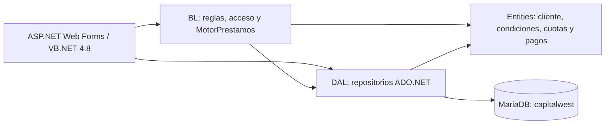

# Auditoría de cumplimiento y pruebas de CapitalWest

**11 de noviembre de 2026, Panamá. Versión: `cd12206` (`origin/main`).**
Referencia: *Proyecto No. 2 DS8*, 8 páginas, secciones 1–19. Los requisitos del PDF se usaron como criterio de evaluación. Los resultados corresponden al código descargado; los ajustes de fixtures se hicieron exclusivamente en la copia de pruebas.

## Dictamen

**Cumplimiento parcial.** El flujo ordinario de crédito funciona en el ambiente probado: clientes, producto, solicitud, evaluación, formalización, cuotas, pagos, cancelación normal, recibos y reportes. Los cinco motores producen los resultados esperados de los ejemplos calculados a mano. No procede declarar cumplimiento total: Consulta puede escribir en Clientes, una sesión anterior sobrevive al cambio de contraseña, programar una tasa futura deja temporalmente inoperable el producto y no existe flujo de refinanciamiento. También hay diferencias en el simulador y faltan entregables identificables en el repositorio.

## Matriz frente al enunciado

| Sección | Evaluación | Evidencia y diferencias |
|---|---|---|
| §§1–3: operación financiera | Parcial | Flujo ordinario y cancelación normal verificados. No hay refinanciamiento/reestructuración ejecutable. |
| §4: cinco métodos | Verificado en motor | Francés, alemán, americano, simple y compuesto. 455 combinaciones adicionales comprobaron suma de capital, cuotas, fechas y saldo final; cinco ejemplos manuales coincidieron. Compuesto es modalidad de pago único. Un extremo del motor falla con desbordamiento, fuera del flujo web mensual. |
| §5: parámetros contractuales | Verificado en flujo ordinario | Solicitud y préstamo vinculados; monto solicitado y fecha en solicitud, aprobado y desembolso en préstamo. Se conservan tasa, método, plazo, periodicidad, costos y calendario. La prueba verificó que cambiar la tasa de producto no altera la pactada. |
| §6: clientes en Panamá | Verificado con excepción de permisos | 96 comprobaciones: personas natural/jurídica, identificación, nombres, teléfono, correo, fechas, ingresos, referencias libres y jerarquía territorial. Altas, edición, búsqueda y estados comprobados. El rol Consulta incumple solo lectura. |
| §7: gestión de préstamos | Parcial | Evaluar, aprobar, rechazar y formalizar verificados, incluida doble formalización rechazada. La tasa se toma de la predeterminada vigente y no se elige en la solicitud; la periodicidad de pago se limita a mensual. |
| §8: simulador | Parcial | Compara francés y alemán sobre el mismo producto; muestra calendario, cuota máxima, intereses, total y desembolso neto. Copiar y pegar a Solicitudes funciona. Tasa informativa del producto, no entrada editable; periodicidad fija mensual. Desbordamiento a ancho móvil. |
| §9: pagos | Verificado en flujo soportado | Importe, cuota, desglose, saldo y usuario registrados; recibo por HTTP; sobrepago, fecha retroactiva, referencia inválida y duplicado rechazados. El pago puede cubrir vencido y cuota del mes, no meses posteriores. |
| §10: estados | Parcial | Solicitud → evaluación → aprobado/rechazado. Formalización guarda el desembolso y deja VIGENTE; el atraso se refleja en consultas y el pago actualiza EN_MORA/VIGENTE/CANCELADO. No se produce la transición REFINANCIADO. |
| §11: seguridad | No cumple por completo | Inicio/cierre, hash PBKDF2, cuatro roles, cambio de clave, activación y restricciones de administración/comprobantes verificados. Consulta desactivó un cliente y una segunda sesión siguió autorizada tras cambiar la clave. Tres páginas no sensibles abren sin login. |
| §12: base relacional | Verificado en instalación limpia | MariaDB 10.4.32, 27 tablas y 15 vistas. Están el SQL, modelo lógico, ER y diccionario. El catálogo adicional se cargó dos veces: 6 productos y 7 tasas en ambas pasadas, contando el producto de prueba y sus dos tasas. |
| §13: extensibilidad | Parcial favorable | Interfaz `IMetodoCalculoPrestamo`, cinco estrategias y registro en `MotorPrestamos`. Incorporar uno nuevo requiere conectar implementación, catálogo y reglas de compatibilidad; editar el catálogo no agrega un algoritmo. |
| §14: diez reportes | Verificados por HTTP | Clientes, vigentes, cancelados, mora, pagos por período, saldos, estado de cuenta, amortización, cartera y comparativo. Los 10 generan resultado y CSV; cuatro vistas imprimibles respondieron. Mora verificada adicionalmente con una cuota realmente vencida. El estado de cuenta funciona en Reportes con préstamo seleccionado; la ruta independiente de Estados de cuenta sigue siendo un marcador. |
| §15: técnica | Parcial | Capas, OOP, transacciones, validación, SQL parametrizado y auditoría. Fallos observados en autorización, sesiones y diseño responsivo. La documentación existente describe una versión anterior en varias secciones. |
| §16: pruebas | Parcial | Montos/plazos pequeños y grandes, tasas cero/baja/normal/alta, períodos diversos en motor, pago normal/parcial, morosidad y concurrencia. No se demuestra liquidación antes de vencimiento: los meses futuros se rechazan. Dos suites del repositorio requieren corregir sus fixtures. |
| §§17–18: entrega y dominio de fórmulas | Parcial | SQL, código, arquitectura básica, diccionario, ER/lógico y fórmulas con ejemplos están disponibles. Este informe aporta plan ejecutado y evidencia. No se encontró un documento consolidado de requisitos, historias/casos de uso, diagramas de uso y clases, manuales técnico y de usuario completos ni presentación de esta versión. No se evaluó la exposición oral. |
| §19: crecimiento | Parcial favorable | Los catálogos, estrategias y capas facilitan cambios, aunque roles y reportes tienen reglas codificadas y requieren modificar la aplicación para añadir comportamientos. |

## Hallazgos reproducibles, en orden de prioridad

| ID | Prioridad | Reproducción y resultado | Corrección esperada |
|---|---|---|---|
| A-01 | Alta | Entrar con rol Consulta, abrir Clientes y enviar la acción de cambio de estado: el servidor confirmó «Estado del cliente actualizado». También mostró el formulario de alta. Se revirtió el cliente ficticio con administrador. `Clientes.aspx.vb`: `NuevoCliente`, `Guardar`, `CambiarEstadoPerfil` y `AccionCliente` no exigen rol de escritura. | Autorizar cada POST de mutación en servidor; administrador/oficial para los cambios permitidos. Ocultar botones a otros roles y agregar regresión HTTP. |
| A-02 | Alta | Abrir dos sesiones ficticias del mismo usuario; cambiar contraseña en la primera; la segunda todavía carga Inicio. El DAL incrementa `VersionSesion`, pero el ticket de `FinanzasPagina.vb` se vuelve a emitir con el identificador y datos de usuario vacíos. La pantalla de cambio solo solicita clave nueva y confirmación. | Asociar versión al ticket, validarla antes de renovar y revocar sesiones anteriores; exigir clave vigente para cambio voluntario o un flujo temporal autenticado para el cambio forzado. |
| A-09 | Alta operativa | Con un producto operable, registrar una tasa cuya vigencia empieza en siete días. `GuardarTasa` desactiva inmediatamente la tasa actual y `PRODUCTOS_OPERABLES` descarta la nueva porque aún no está vigente. El producto desapareció hasta restablecer una tasa vigente. | Mantener vigente la tasa actual hasta que empiece la nueva, o rechazar fechas futuras si la interfaz solo admite sustitución inmediata. Probar ambos lados de la fecha de cambio. |
| A-03 | Alta de cumplimiento | Existe tabla `Refinanciamientos` y etiqueta REFINANCIADO, sin comando, caso de uso o pantalla ejecutable. No hay liquidación anticipada de meses futuros; el intento fue rechazado. | Implementar refinanciamiento/reestructuración con vínculo entre contratos, saldo conciliado y auditoría. Definir y probar liquidación anticipada según el enunciado. |
| A-04 | Media de cumplimiento | En Simulador y Solicitudes el usuario no puede elegir otra tasa y la frecuencia de pago queda mensual; el motor sí soporta otras frecuencias. | Ofrecer selecciones según las opciones autorizadas del producto o documentar y obtener aceptación de esa restricción. |
| A-05 | Media | A 390 px de viewport, el Simulador ocupa 469 px con 375 px útiles: 94 px de desbordamiento. Otras ocho pantallas no desbordaron en esa muestra. | Corregir mínimos de cuadrícula y contenedores, y repetir con formularios y tablas llenas. |
| A-06 | Media | `EstadosCuenta/EstadosCuenta`, About y Contact respondieron sin autenticación. Son páginas de plantilla/marcador y no se observó exposición de datos allí; las 19 rutas operativas probadas redirigieron a Acceso. | Proteger rutas funcionales por defecto y redirigir Estados de cuenta al reporte pertinente o completarla. |
| A-07 | Baja | El motor compuesto con B/. 1,000, 100% anual, 1 período/año y 1,200 cuotas lanza `OverflowException` en vez de un rechazo controlado. El caso excede el plazo/periodicidad de la interfaz. | Validar el límite de crecimiento antes de convertir a Decimal y emitir error de dominio. |
| A-08 | Media para la entrega | `FinanzasTests.cs` usa 0.01 meses donde ahora se exige entero de 1–120; `AccionesProductoTests.cs` no copia `ParametrosSistema`, requerida por autorización. Ambas fallan sin adaptar. | Alinear datos de prueba y clonado con el esquema/reglas, y ejecutar automáticamente sobre un esquema fresco. |

## Plan ejecutado y resultados

Se compiló la solución con MSBuild y se precompilaron los ASPX. Se importó el esquema en `capitalwest_pruebas_finanzas`, se usó una copia de IIS Express con otra cookie y se emplearon exclusivamente cuentas, clientes y contratos ficticios. No se apuntaron los lanzadores de escritura a la base de trabajo.

| Grupo | Resultado |
|---|---|
| Captura y validación | 51 comprobaciones aprobadas sin BD. |
| Clientes | 96 aprobadas, con reversión de sus datos. |
| Finanzas | Suite original interrumpida por plazo fraccionario; 85 aprobadas al usar 1 mes solo en el fixture de copia. |
| Catálogo y mensualidad | 16 y 31 aprobadas con catálogo y contratos de prueba. |
| Acciones de producto | El clon original falla por tabla de parámetros ausente. 8 aprobadas al incluirla en la copia: autorización, bloqueo de producto utilizado, cambio de estado y eliminación sin operaciones. |
| Reportes DAL | 31 aprobadas: consultas, fechas, filtros, exportación CSV e inyección de fórmulas. |
| Flujos adicionales | 12 aprobadas: administración de usuarios, clave, estado, mora real, pago del mes y rechazo de liquidación futura. |
| Motor adicional | 455 combinaciones pasaron invariantes; 5 oráculos manuales coinciden; 1 extremo falla de forma no controlada. |
| HTTP | 71 comprobaciones positivas y 4 negativas en la matriz general: 3 páginas públicas y alta disponible a Consulta. Se reprodujo la mutación real y la persistencia de sesión en pruebas específicas posteriores. |
| Concurrencia y carga | Dos cobros simultáneos con la misma clave dieron un recibo. 40 GET con 4 concurrentes, sin fallos, mediana 0.031 s y máximo 1.533 s en entorno local; no es una prueba de capacidad de producción. |
| Integridad | 0 aplicaciones huérfanas, 0 cobros desbalanceados, 0 préstamos cancelados con saldo y 0 préstamos duplicados por solicitud; los triggers rechazaron UPDATE y DELETE de auditoría. |
| Navegador | 9 pantallas a 390, 768 y 1,280 px (27 mediciones); 1 desbordamiento observado. Comparación francés/alemán y transferencia de producto, B/. 3,000 y 6 meses a Solicitudes comprobadas. |
| Tasas y seguridad específicas | Tasa futura dejó inoperable un producto; segunda sesión sobrevivió al cambio de contraseña. Entrada tipo SQL en login no autenticó; Consulta y Oficial no recibieron el comprobante, Cajero sí. |

Las comprobaciones de distintas suites pueden repetirse. No se infiere un porcentaje global de cumplimiento a partir de sus totales.

## Evidencia de los métodos

Ejemplo independiente: principal B/. 1,000, 3 meses, tasa nominal anual 12%, capitalización mensual; (i=1%) mensual. El interés se redondea a centavos por cuota; el saldo se cierra en la última. Primera fecha 31/01/2027, después 28/02 y 31/03.

| Método | Referencia manual | Intereses esperados / obtenidos | Pagos del motor |
|---|---|---:|---|
| Francés | Cuota teórica (P i/(1-(1+i)^{-n})); capital = cuota − interés | 20.07 / 20.07 | 340.02; 340.02; 340.03 |
| Alemán | Principal dividido entre 3 y saldo × 1% para cada interés | 20.00 / 20.00 | 343.33; 340.00; 336.67 |
| Americano | 10 por período más todo el capital al final | 30.00 / 30.00 | 10.00; 10.00; 1,010.00 |
| Simple | (P × r × 3/12), distribuido sobre tres cuotas | 30.00 / 30.00 | 343.33; 343.33; 343.34 |
| Compuesto | (P(1.01)^3-P), pago único | 30.30 / 30.30 | 0.00; 0.00; 1,030.30 |

La matriz usó cuatro montos (0.01, 200, 10,000 y 10 millones), plazos de 1/6/60/120 y tasas de 0/0.000001/12/100% en frecuencia mensual. Agregó 135 combinaciones a 4/24/52 períodos por año en el motor, con plazos de 2/12/24 y tasas de 1/12/37%. El log del motor conserva las 15 filas completas con saldo.

## Entregables del §17

| # | Entregable | Estado verificable en el repositorio o en esta auditoría |
|---|---|---|
| 1 | Documento de requerimientos | Enunciado externo y matrices de cobertura; falta consolidar requisitos de esta versión. |
| 2 | Historias o casos de uso | No se localizaron como entregable. |
| 3 | Diagrama de casos de uso | No se localizó. |
| 4 | Diagrama de clases | No se localizó como entregable actualizado. |
| 5 | Modelo entidad-relación | `Database/MySQL/CapitalWest/Modelo_entidad_relacion.mmd`; también modelo lógico en Markdown. |
| 6 | Diccionario de datos | `Database/MySQL/CapitalWest/Diccionario_datos.md`. |
| 7 | Diseño de arquitectura | Hay descripción por capas y dependencias; verificar que la entrega incluya la versión actual. |
| 8 | Base y SQL | Esquema limpio y catálogo adicional importados y comprobados. |
| 9 | Código fuente | Solución de cuatro proyectos compilada. |
| 10 | Manual técnico | Hay notas de instalación, módulos y BD; no un manual técnico completo actualizado. |
| 11 | Manual de usuario | No se localizó uno completo para esta versión. |
| 12 | Plan de pruebas | Suites existentes más el plan ejecutado de este informe; faltan criterios de aceptación para los casos abiertos. |
| 13 | Evidencia de cinco métodos | Fórmulas en `docs/Calculos_financieros.md` y ejemplos, cuotas y resultados en este informe y el log del motor. |
| 14 | Presentación y demo | Demo local parcial verificada; no se localizó presentación ni se evaluó la exposición. |

## Arquitectura, datos y repetición

El cliente enlaza solicitudes y préstamos. El producto tiene tasas y asociaciones de métodos/periodicidades. Una solicitud se formaliza en un préstamo; el préstamo tiene cuotas, pagos y movimientos. AplicacionesPago enlaza pagos con cuotas; UsuarioRoles vincula usuarios y roles. Auditoría guarda las operaciones y sus triggers protegen los registros.

Para repetir: compilar los cuatro proyectos con Visual Studio, importar `Database/MySQL/CapitalWest/CapitalWest.sql` con destino **aislado** y ejecutar los scripts de `Tests`. El runner financiero requiere literalmente `capitalwest_pruebas_finanzas`. Los runners de catálogo, mensualidad, reportes y acciones leen `Web.config`; preparar una copia del proyecto con esa conexión. Usar el fixture de plazo entero y añadir `ParametrosSistema` al clonado de acciones. Cargar `20261030_catalogo_productos.sql` solo en la base de prueba. Los scripts complementarios y registros se conservan como evidencia; los flujos de prueba cambian datos ficticios y se repiten sobre una base nueva.

Alcance de la verificación: Windows, IIS Express, Chromium integrado y MariaDB local. No se realizó un pentest exhaustivo, pruebas de producción, prueba cruzada en otros navegadores ni impresión física. Las vistas imprimibles fueron verificadas por HTTP, no como archivos PDF finales.
