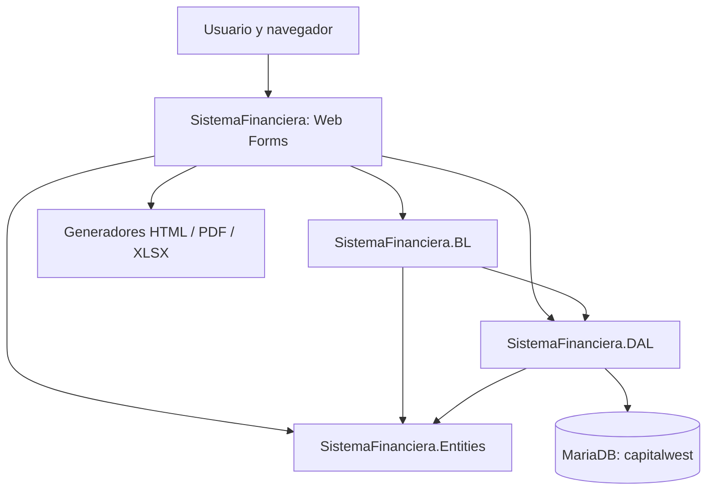
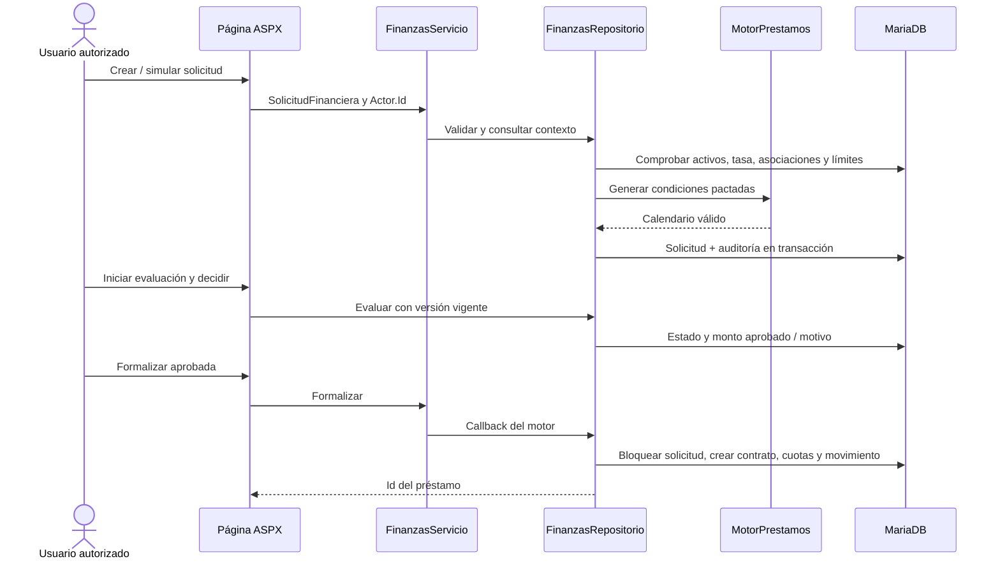
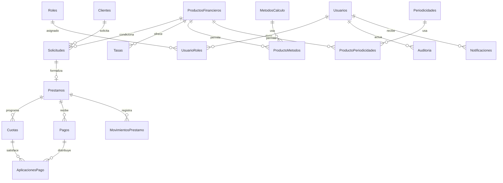

# Contexto técnico de CapitalWest

Fecha del escaneo: **18 de noviembre de 2026**.
Repositorio: `C:/Users/rafae/source/repos/SistemaFinanciera`.
Commit de referencia: `eafbb35101245e82c450ffcb41d3f907d3f25056`.
Incluye los cambios locales de autenticación y política de contraseña todavía sin confirmar en Git.
Método: lectura de código VB, ASPX, JavaScript, proyectos, SQL, pruebas y consulta de metadatos de MariaDB.
Skill aplicada: `C:/Users/rafae/Downloads/deep-project-scanner/SKILL.md`.

## 1. Alcance y uso del documento

Este es un contexto técnico de la implementación existente, preparado como fuente para futuros entregables.
No sustituye el enunciado, la rúbrica, el manual de usuario ni un acta de aceptación.
En este escaneo no se modificaron funciones ni registros operativos de la base.
No se volvió a ejecutar toda la batería de pruebas; se distinguen las verificaciones recientes de los scripts disponibles.
Los dos PDF mencionados en el chat deberán contrastarse directamente al elaborar la matriz de cumplimiento formal.
No se debe afirmar cumplimiento total del proyecto académico a partir de este documento.

Las referencias a archivos son relativas a la raíz del repositorio, salvo indicación contraria.
Las firmas del anexo sirven para localizar código; las reglas explicadas en el cuerpo describen su comportamiento.
El diccionario final proviene de metadatos de la base local y no contiene filas de clientes, usuarios ni operaciones.
Una tabla, un campo o un estado disponible en SQL no demuestra que exista un flujo de interfaz que lo utilice.

## 2. Descripción general

CapitalWest es una aplicación web de gestión de clientes y préstamos para operación interna.
Trabaja con moneda balboas (B/.) y fechas operativas de Panamá.
Integra registro de clientes naturales y jurídicos, productos financieros, tasas, solicitudes, simulación, contratos, cuotas, pagos, reportes y administración.
El flujo principal registra una solicitud, permite una evaluación humana, formaliza el préstamo aprobado y aplica pagos al calendario persistido.
El simulador también funciona sin crear una solicitud ni un contrato.
Los usuarios se autentican y acceden a pantallas y operaciones según roles predefinidos.
No se encontró integración de desembolso o cobro bancario, pasarela de pago, envío de correo ni servicio financiero externo.

## 3. Stack y solución

| Componente | Implementación observada |
|---|---|
| Aplicación | ASP.NET Web Forms, VB.NET, .NET Framework 4.8 |
| Solución | `SistemaFinanciera.sln` y `SistemaFinanciera.slnx`, los mismos cuatro proyectos |
| IDE indicado por solución | Visual Studio versión 18; los runners de pruebas también contienen rutas locales de herramientas |
| Servidor de desarrollo | IIS Express; proyecto web con inicio en `Acceso.aspx` |
| Persistencia | MariaDB 10.4.32 local, InnoDB, esquema `capitalwest` |
| Acceso SQL | MySqlConnector 2.6.2 mediante PackageReference en DAL |
| Modelo de acceso | SQL directo parametrizado; listas de entidades, DataTable y DataSet |
| ORM | No se encontró DbContext ni un ORM que gobierne el esquema |
| Autenticación | Forms Authentication, cookies de sesión, comprobación de usuario/roles en BD |
| Estado temporal | Session InProc y ViewState por página |
| Interfaz | MasterPage, CSS propio, JavaScript propio, controles Web Forms |
| Cotizaciones PDF | Generador propio con System.Drawing, fuentes Helvetica/WinAnsi |
| Cotizaciones Excel | Generador propio ZIP/Office Open XML, sin automatizar Excel |
| Pruebas | Runners PowerShell, casos C#, pruebas HTTP Python/lxml |

Dependencias declaradas del proyecto web en `packages.config`:

| Paquete | Versión |
|---|---|
| Antlr | 3.5.0.2 |
| bootstrap | 5.2.3 |
| jQuery | 3.7.0 |
| Microsoft.AspNet.FriendlyUrls.Core y recurso es | 1.0.2 |
| Microsoft.AspNet.ScriptManager.MSAjax | 5.0.0 |
| Microsoft.AspNet.ScriptManager.WebForms | 5.0.0 |
| Microsoft.AspNet.Web.Optimization y recurso es | 1.1.3 |
| Microsoft.AspNet.Web.Optimization.WebForms | 1.1.3 |
| Microsoft.CodeDom.Providers.DotNetCompilerPlatform | 2.0.1 |
| Microsoft.Web.Infrastructure | 2.0.0 |
| Modernizr | 2.8.3 |
| Newtonsoft.Json | 13.0.3 |
| WebGrease | 1.6.0 |

La tabla refleja versiones declaradas, no una evaluación de vulnerabilidades ni de vigencia de paquetes.
Los binding redirects de Web.config también incluyen Tasks.Extensions y Runtime.CompilerServices.Unsafe.
No se encontraron frameworks internos propietarios.

## 4. Arquitectura real



La presentación referencia directamente DAL para construir repositorios y para algunas operaciones auxiliares.
La separación por capas existe, pero no debe describirse como independencia total entre presentación y datos.
BL depende del repositorio concreto FinanzasRepositorio; Clientes dispone de la interfaz IClienteRepositorio en Entities.
No se encontraron controladores REST, contratos WCF ni endpoints SOAP de negocio.
Las operaciones se exponen al usuario mediante páginas ASPX y eventos de postback.

| Proyecto | Responsabilidad y clases principales |
|---|---|
| SistemaFinanciera | Páginas, autenticación HTTP, permisos de pantalla, menús, formularios, renderizado y exportación |
| SistemaFinanciera.BL | ClienteServicio, FinanzasServicio, MotorPrestamos, cinco métodos nativos, parser y métodos por opciones |
| SistemaFinanciera.DAL | ClienteRepositorio y FinanzasRepositorio; SQL, transacciones, bloqueos, autorización de escrituras financieras |
| SistemaFinanciera.Entities | Cliente, IClienteRepositorio y DTO de usuario, producto, solicitud, condiciones, cuota y pago |

Los Class1.vb vacíos son residuos de plantillas, no componentes funcionales.
Los archivos `.designer.vb` y `My Project` contienen soporte generado por Visual Studio.

## 5. Mapa de archivos clave

```text
SistemaFinanciera.sln / .slnx                 ← solución de cuatro proyectos
SistemaFinanciera/
  Acceso.aspx + .vb                          ← login y alta local inicial
  AutenticacionSesion.vb                     ← ejecución y versión del ticket
  FinanzasPagina.vb                          ← guardia común de páginas operativas
  AccesoPantallas.vb                         ← matriz de roles por ruta
  Global.asax.vb                            ← rutas, bundles y rechazo de tickets previos
  Site.Master + .vb                         ← estructura, usuario, menú y notificaciones
  Default.aspx.vb                           ← dashboard con datos financieros
  Clientes/Clientes.aspx.vb                  ← directorio, ficha, formulario y CSV
  Productos/Productos.aspx.vb                ← productos y tasas
  Solicitudes/Solicitudes.aspx.vb            ← creación, simulación y evaluación
  Prestamos/Prestamos.aspx.vb                ← cartera y formalización
  Prestamos/DetallePrestamo.aspx.vb          ← contrato, cuotas y movimientos
  Pagos/Pagos.aspx.vb                       ← cobro, exigible e historial
  Pagos/Factura.aspx.vb                     ← comprobante imprimible
  Simulador/Simulador.aspx.vb                ← simulación independiente y comparación
  Simulador/Cotizacion.vb                   ← DTO y documento HTML
  Simulador/CotizacionPdf.vb                ← generación de PDF
  Simulador/CotizacionExcel.vb              ← generación de XLSX
  Reportes/Reportes.aspx.vb                 ← diez informes, gráficas, CSV e impresión
  Administracion/Usuarios.aspx.vb           ← cuentas, roles asignados y recuperación
  Administracion/Roles.aspx.vb              ← consulta de roles existentes
  Administracion/Catalogos.aspx.vb          ← consulta y cambios de estados admitidos
  Administracion/MetodosCalculo.aspx.vb     ← métodos nativos y personalizados
  Administracion/Parametros.aspx.vb         ← nueve parámetros editables
  Administracion/Auditoria.aspx.vb          ← filtros, detalle y CSV de eventos
  Administracion/CambiarClave.aspx.vb       ← cambio de clave propia
  EstadosCuenta/EstadosCuenta.aspx         ← pantalla de reserva, sin flujo operativo
  Scripts/FinanzasFormularios.js            ← validación compartida de formularios
  Scripts/PoliticaClave.js                  ← guía dinámica y coincidencia de claves
  Scripts/Acceso.js                         ← interacción del login
  Scripts/StitchClientes.js                 ← interacción específica de clientes
  Scripts/StitchProductos.js                ← interacción específica de productos
  Scripts/CapitalWest.js / Dashboard.js     ← navegación e interacción general
  Content/PoliticaClave.css                 ← estilo compartido de claves
  Web.config                               ← conexión, autenticación y runtime
SistemaFinanciera.BL/
  ClienteServicio.vb                        ← normalización y validación de clientes
  FinanzasServicio.vb                       ← validación y coordinación financiera
  CalculosPrestamos.vb                      ← motor y cinco algoritmos
  ExpresionFinanciera.vb                    ← lenguaje de fórmulas y evaluación
  MetodoPorOpciones.vb                      ← opciones convertidas en fórmulas
SistemaFinanciera.DAL/
  ClienteRepositorio.vb                     ← CRUD y ubicación de clientes
  FinanzasRepositorio.vb                    ← operaciones y consultas financieras
SistemaFinanciera.Entities/
  Cliente.vb / Finanzas.vb                  ← contratos de datos
Database/MySQL/CapitalWest/
  CapitalWest.sql                          ← esquema de instalación nueva
  20261111_notificaciones.sql               ← actualización de notificaciones
  20261112_codigos_productos.sql            ← normalización de códigos de productos
  20261112_metodos_expresiones.sql          ← soporte de fórmulas
Tests/                                     ← runners y casos de prueba
docs/                                      ← documentación de distintas etapas
```

## 6. Entidades y contratos

| Tipo | Propiedades y propósito |
|---|---|
| Cliente | Id, tipo de persona/identificación, identificación, datos personales/contacto/laborales, ubicación, ingresos, referencias, Activo, Version Byte() |
| IClienteRepositorio | Listar, Obtener, Guardar, EstadosCivilesActivos, EstadoCivilActivo, CambiarEstado |
| UsuarioFinanzas | Id, Nombre, Roles String(), DebeCambiarClave, MinutosInactividad, VersionSesion; Puede(roles) |
| ProductoFinanciero | Identidad, descripción, límites, tasa, capitalización, costos y listas de métodos/periodicidades |
| SolicitudFinanciera | Clave de formulario, cliente/producto/método/periodicidad, monto, cuotas, primer pago y observaciones |
| CondicionesPrestamo | Entrada del motor: monto, tasa/tipo, frecuencias, intervalo, cantidad, fecha, código y expresiones |
| CuotaPlan | Numero, Fecha, Capital, Interes, Saldo; Cuota = Capital + Interes |
| PagoFinanciero | PrestamoId, Monto, Fecha, Forma, Referencia, Clave |
| OpcionesMetodo | FormaCapital, BaseInteres, PagoInteres, CuotasGracia, PorcentajeGlobo, PorcentajeCrecimiento |
| FormulasGeneradas | Variables, ExprInteres, ExprCapital, ExprSaldo, Descripcion, Formula, Algoritmo |
| CotizacionPrestamo | Datos opcionales de cliente, condiciones, asesor, Plan y totales derivados; serializable para Session |

Las consultas generales devuelven DataTable y DataSet, no DTO por cada vista SQL.
No existe una clase de entidad por cada tabla; no confundir el inventario de DTO con el modelo relacional completo.
En Cliente, Version se transporta como ocho bytes y se convierte a BIGINT UNSIGNED para concurrencia optimista.

Contrato de cálculo real:

```vb
Public Interface IMetodoCalculoPrestamo
    Function Generar(c As CondicionesPrestamo, tasaPeriodica As Decimal) As List(Of CuotaPlan)
End Interface
```

## 7. Acceso, autenticación y administración

FinanzasPagina.OnInit asigna ViewStateUserKey desde un token de sesión, exige autenticación, carga el actor vigente y comprueba la versión del ticket.
Actualiza la duración por inactividad, renueva la cookie y evita caché de las páginas operativas.
Si DebeCambiarClave está activo, dirige a CambiarClave antes de permitir el resto de pantallas.
AccesoPantallas regula navegación y acceso directo; las escrituras financieras vuelven a autorizar dentro del repositorio.
Las rutas desconocidas no se deniegan automáticamente en AccesoPantallas: RolesDe devuelve Nothing y Permite acepta ese caso para un usuario existente.
Una nueva página operativa debe heredar FinanzasPagina y agregarse expresamente a la matriz.

| Pantalla o acción | Administrador | Oficial de crédito | Cajero | Consulta |
|---|---|---|---|---|
| Inicio, préstamos y detalle | Sí | Sí | Sí | Sí |
| Clientes: consultar | Sí | Sí | No | Sí |
| Clientes: gestionar | Sí | Sí | No | No |
| Productos: consultar | Sí | Sí | No | Sí |
| Productos y tasas: gestionar | Sí | No | No | No |
| Simulador independiente | Sí | Sí | No | No |
| Solicitudes: consultar | Sí | Sí | No | Sí |
| Crear solicitud | Sí | Sí | No | No |
| Evaluar/aprobar/rechazar y formalizar | Sí | No | No | No |
| Pagos: consultar | Sí | No | Sí | Sí |
| Registrar pago y ver Factura | Sí | No | Sí | No |
| Reportes: pantalla | Sí | No | No | Sí |
| Administración, salvo CambiarClave | Sí | No | No | No |
| CambiarClave | Sí | Sí | Sí | Sí |

La DAL permite consultar reportes a los cuatro roles; la pantalla restringe a Administrador/Consulta.
Es una diferencia entre permiso de servicio y permiso de interfaz, no un permiso configurable por reporte.
RolesAdmin lista los roles; no implementa un diseñador de permisos ni creación libre de roles.
UsuarioRoles permite M:N, pero el formulario de gestión reemplaza la asignación por un único rol elegido.
Se impide desactivar la propia cuenta y retirar el último administrador activo mediante las operaciones previstas.

### 7.1 Contraseñas y sesiones

Hash: PBKDF2-SHA256, 210000 iteraciones, sal aleatoria de 16 bytes y resultado de 32 bytes.
El hash guarda algoritmo, iteraciones, sal y derivado; no almacena la clave en texto plano.
La política corriente parte de mínimo 8 y máximo 128; mayúscula y número son parámetros configurables.
El mínimo administrativo admite 8–64. No hay requisito obligatorio de minúscula o símbolo en ValidarClave.
CrearAdministrador conserva una excepción de máximo 20; no debe documentarse como idéntico al alta administrativa normal.
El login admite contraseña de hasta 128 y consulta por usuario/correo.
Hay bloqueo temporal configurable y comprobación de intentos con bloqueo de fila en ResultadoLogin.
La recuperación es administrativa: clave aleatoria temporal o restablecimiento manual; se obliga cambio posterior.
No se encontró un flujo de recuperación autónoma por correo/token.
La guía de Crear usuario y CambiarClave comparte JS/CSS y metadatos obtenidos de PoliticaClaveActual.

AutenticacionSesion emite UserData `cw1:identificadorEjecucion:VersionSesion` en un ticket no persistente.
El identificador cambia al reciclar el AppDomain; Global rechaza la cookie de una ejecución anterior.
FinanzasPagina verifica VersionSesion contra BD: un cambio/restablecimiento invalida otros tickets.
CambiarClave renueva únicamente la sesión que completó el cambio con la versión nueva.
Abrir Acceso con una cookie válida la cierra y vuelve a solicitar credenciales; cubre reapertura desde Visual Studio cuando IIS sigue vivo.
Session es InProc: cotizaciones, planes y otros datos temporales se pierden con el proceso.
Este esquema se documenta para el despliegue local actual; no está preparado como autenticación compartida entre múltiples workers con identificadores distintos.

## 8. Clientes

ClienteServicio normaliza espacios, Unicode y teléfono; acepta +507 y separadores antes de persistir 7–8 dígitos.
No acepta teléfono compuesto solo por ceros.
Natural admite cédula o pasaporte; jurídica exige RUC y limpia campos personales no aplicables.
La identificación es única incluso para clientes inactivos.
La cédula, pasaporte y RUC tienen patrones propios; el pasaporte acepta 5–30 letras/números.
Nombres/apellidos de natural admiten letras, acentos y separadores de nombres, no cadenas numéricas.
Los límites de negocio son más estrechos que varias columnas SQL.
Natural requiere nacimiento no futuro dentro de 120 años, sexo y estado civil válido/activo.
Razón social debe contener letras; no se valida como nombre de persona.
El correo requiere formato y dominio con punto; el límite de negocio es 35 caracteres.
Dirección, ocupación y referencias requieren texto útil y longitudes limitadas.
Referencias es texto libre: exige letras y un teléfono válido, sin imponer CSV, orden o una referencia por línea.
La interfaz guarda ese texto en Clientes.Referencias; ReferenciasCliente es una estructura adicional sin escritura en ClienteRepositorio.
Provincia/distrito/corregimiento se seleccionan jerárquicamente y DAL resuelve los nombres desde códigos válidos.
Guardar/editar/cambiar estado usa versión optimista; si cambió el registro, exige volver a abrirlo.
El guardado y su aviso de auditoría se hacen en operaciones separadas: un fallo del aviso puede dejar cliente guardado sin el evento.
CambiarEstado en ClienteRepositorio no inserta por sí mismo un evento de auditoría.
La autorización de gestión de clientes se exige en la página; IClienteRepositorio no recibe actor para reautorizar en SQL.
Hay listado, filtros, paginación, ficha con datos financieros, activar/desactivar y exportación CSV con escape de fórmulas.

## 9. Productos y tasas

Productos permite alta, edición, consulta, activación/desactivación y eliminación condicionada.
El alta genera `PRO-000001` a partir del Id; no debe describirse como código libre introducido por el usuario.
Nombre: 3–80, empieza con letra y admite números posteriores y signos habituales; descripción hasta 500 con letras.
Montos positivos con dos decimales, máximo monetario general 999999999999.99.
Plazos/cuotas de producto: 1–120; meses enteros, máximo coherente con mínimo.
Tasa anual 0–100, hasta seis decimales; nominal o efectiva anual.
GuardarProducto exige una periodicidad mensual y capitalización mensual activa.
Aunque Periodicidades contiene otras frecuencias, los flujos nuevos no las ofrecen como pagos operativos.
Comisión FIJO o PORCENTAJE mediante CalcularComision; gastos de este formulario se guardan como FIJO.
Costos calculados más gastos no pueden superar el monto mínimo.
Los costos se retienen en desembolso; no se suman otra vez a cada cuota.
Al cambiar tasa se conserva historial; se selecciona tasa activa, predeterminada y vigente para una nueva solicitud.
No se pueden retirar asociaciones utilizadas por solicitudes; la relación histórica se conserva.
Las escrituras de producto, asociaciones, tasa y auditoría se ejecutan dentro de una transacción.

## 10. Solicitudes y formalización



La solicitud exige cliente/producto activos, método/periodicidad permitidos, tasa vigente, monto/plazo admitidos y fecha futura hasta dos años.
Observaciones es opcional, hasta 1000 y con letras si se completa.
La clave de formulario hexadecimal permite reconocer reenvíos idénticos; la clave reutilizada con otros datos se rechaza.
El folio visible usa `SOL-` + Id de al menos seis cifras; NumeroSolicitud persistido puede contener GUID para idempotencia.
Estados de solicitud: SOLICITUD → EN_EVALUACION → APROBADO o RECHAZADO.
Evaluar requiere versión actual, impide saltos y exige motivo al rechazar.
Monto aprobado positivo, no superior al solicitado y compatible con costos/producto activo.
La decisión es humana; los ingresos y cuota estimada no equivalen a aprobación automática.
Formalizar exige aprobada, versión actual, cliente/producto y catálogos activos y ausencia de contrato anterior.
Prestamos.SolicitudId UNIQUE impide dos préstamos para la misma solicitud.
Primer pago contractual debe ser exactamente un período completo desde la fecha operativa actual; actualmente mensual.
Contrato y desembolso se realizan juntos; se asigna VIGENTE y se registra movimiento de capital.
No hay etapa de desembolso bancario externo ni paso persistido independiente DESEMBOLSADO.
Se copian monto, tasa, tipo, capitalización, costos y cuotas al préstamo; las cuotas quedan persistidas.
El folio visible es `PRE-000001`; el identificador persistido original puede contener GUID.

## 11. Motor financiero y fórmulas

MotorPrestamos.Generar valida monto y periodicidad, resuelve un método y calcula tasa periódica.
Nominal: `i = (1 + r/m)^(m/f) - 1`; efectiva anual: `i = (1+r)^(1/f) - 1`.
`r = tasa anual/100`, `m = capitalizaciones por año`, `f = pagos por año`.
Dinero usa Decimal.Round a dos decimales con MidpointRounding.AwayFromZero.
Se ajusta la última amortización para que la suma del capital sea exactamente el monto.
El motor exige cantidad correcta, saldo final cero, capital total igual al principal y componentes no negativos.
Máximo interno: 1200 cuotas; servicios operativos limitan a 120.
Fechas desde la primera fecha con AddMonths/AddDays, preservando el ancla original.
No se encontró calendario de feriados ni ajuste a días hábiles.

| Código | Implementación | Comportamiento |
|---|---|---|
| FRANCES | MetodoFrances | Cuota teórica fija; interés sobre saldo, última cuota ajustada |
| ALEMAN | MetodoAleman | Capital constante redondeado, interés sobre saldo |
| AMERICANO | MetodoAmericano | Interés periódico sobre principal y capital completo al final |
| SIMPLE | InteresSimple | Interés anual proporcional `P*r*n/f`; exige nominal; distribuye capital/interés |
| COMPUESTO | InteresCompuesto | Capitalización proyectada, sin cobros intermedios, pago único al final |

Saldo proyectado de COMPUESTO incluye acumulación teórica; no equivale siempre a SaldoCapital contable.
Registrar(codigo, metodo) permite extender el motor por código .NET.
Los métodos de BD con expresiones se ejecutan mediante MetodoExpresion sin compilar VB dinámicamente.
ClaseImplementacion de SQL es descriptiva; MotorPrestamos decide con su diccionario y expresiones.

### 11.1 Lenguaje de expresiones

ExpresionFinanciera implementa tokenizador, parser y árbol de nodos evaluados con Decimal.
Admite operadores aritméticos, potencia, comparaciones y funciones if/min/max/abs/round/floor/ceil/pow/and/or/not.
Las variables base incluyen datos del contrato y del período; la fórmula de capital puede usar el interés ya calculado.
Las definiciones se resuelven en orden y no pueden duplicar ni reemplazar nombres reservados.
ExprSaldo vacía usa saldo menos capital; interés/capital se redondean y validan al construir el plan.
Límites del parser: 2000 caracteres por expresión, 200 tokens, profundidad 30 y 30 definiciones.
En administración, BL limita además las fórmulas individuales a 500 caracteres y variables a 2000.
Al guardar se prueban muestras de 1, 3 y 12 cuotas; son validaciones de muestra, no demostración de validez universal.
Los métodos nativos no cambian algoritmo al editar su descripción; los personalizados sí conservan expresiones ejecutables.

MetodoPorOpciones genera las mismas expresiones desde cuota fija, capital fijo, pago al vencimiento o cuota creciente.
Permite gracia 0–60, globo 0–90% y crecimiento 0–20% con restricciones de combinación.
La gracia efectiva se reduce hasta n−1 para evitar consumir todo el plazo.
La última cuota paga el saldo residual; en cuota creciente se evita amortización negativa en los componentes.

## 12. Pagos, movimientos y estados

RegistrarPago autoriza Administrador/Cajero y bloquea el préstamo antes de consultar/aplicar saldos.
La fecha del pago debe ser el día operativo actual de Panamá; rechaza fechas anteriores y futuras.
Admite cuotas vencidas y las programadas hasta el último día del mes actual.
Por tanto, puede cobrarse una cuota del mes todavía no vencida; no es correcto describirlo como solo vencidas al día.
Rechaza meses futuros y sobrepagos del total permitido del mes.
El orden es número de cuota; dentro de cada cuota: mora → otros cargos → interés → capital.
Forma de pago activa, referencia requerida para formas no efectivas según la validación del servicio.
Clave idempotente reconoce mismo pago y rechaza reutilización con datos distintos.
Recibo, aplicaciones, saldo, estado, movimientos y auditoría se confirman juntos o se revierten.
Los cargos contractuales de cuota se reconocen una vez al entrar en aplicación, comprobando movimiento existente.
El recibo usa `FAC-` + Id con mínimo cuatro dígitos; la factura es un comprobante interno imprimible.
La cancelación NORMAL se produce cuando no queda pendiente del plan; preserva cuotas y pagos.
El estado EN_MORA se detecta en consultas y se persiste según mora residual al pagar; no hay tarea programada observada de actualización diaria.
SaldoCapital representa capital pendiente; el saldo acumulado de movimientos incluye débitos/créditos reconocidos.
No debe interpretarse el interés futuro del calendario como importe automático de liquidación anticipada.

## 13. Simulador y cotizaciones

El simulador independiente consulta productos operables con tasa vigente y métodos habilitados.
Calcula plan, totales, cuota máxima y comparación con otros métodos del mismo producto.
Guarda plan/cotización en Session; no inserta solicitud, préstamo ni cuota.
Datos del destinatario opcionales: cliente registrado o prospecto con datos manuales.
Imprimir cotización genera HTML formal y llama window.print tras la carga.
El documento de impresión está oculto fuera de la impresión mediante CSS.
PDF descarga bytes del generador propio en tamaño carta con tabla paginada, logo y fuentes estándar.
XLSX genera un paquete Office Open XML con estilos, fechas e importes numéricos.
No debe llamarse CSV a la descarga XLSX del simulador.
El aviso de cotización indica que es informativa y no constituye aprobación u oferta vinculante.
Los números/datos de cotización no son un repositorio persistido de cotizaciones.
Por las fuentes WinAnsi del PDF, conviene comprobar visualmente nombres con caracteres fuera de ese repertorio antes de entregar ejemplos.

## 14. Reportes y exportación

| N.º | Reporte | Fecha filtrada y significado |
|---|---|---|
| 1 | Clientes registrados | Registro del cliente; incluye activos/inactivos |
| 2 | Préstamos vigentes | Desembolso; incluye activos en mora |
| 3 | Préstamos cancelados | Cancelación |
| 4 | Préstamos en mora | Vencimiento; una fila por cuota |
| 5 | Pagos por período | Fecha de pago aplicado; excluye anulados |
| 6 | Saldos pendientes | Desembolso; saldos actuales |
| 7 | Estado de cuenta | Movimiento; saldo incluye movimientos anteriores al filtro |
| 8 | Amortización | Vencimiento de cuota |
| 9 | Resumen de cartera | Desembolso; agrupación por producto/estado actual |
| 10 | Comparativo de métodos | Desembolso; agregados de contratos existentes |

Fechas finales se convierten en límite exclusivo del día siguiente para incluir el día completo.
Estado de cuenta y amortización exigen préstamo elegido.
Exportar/imprimir usan los filtros con los que se generó el resultado, almacenados en ViewState.
La consulta se ejecuta nuevamente al exportar/paginar, por lo que no es una instantánea inmutable.
CSV usa UTF-8, comillas y protección ante inicios de fórmula; impresión ofrece guardar PDF desde el navegador.
La pantalla genera gráficas, pero no utiliza el generador de PDF de cotizaciones para los reportes.
El comparativo de cartera no es un experimento con monto/plazo iguales; el simulador sí permite comparación con condiciones comunes.
La ruta separada EstadosCuenta sigue como pantalla de reserva; la función real está en Reporte 7 y detalle de préstamo.

## 15. Base de datos y relaciones

Metadatos locales consultados el 18/11/2026: **MariaDB 10.4.32, 28 tablas, 15 vistas y 2 triggers; sin rutinas almacenadas listadas**.
El SQL canónico también define 28 tablas; su comentario y LEEME aún dicen 27 porque no contabilizan Notificaciones.
Coincidir en nombres y cantidades de objetos no significa que coincidan sus restricciones.
La instalación local tiene **5 restricciones FOREIGN KEY, 0 CHECK, 25 PRIMARY KEY y 27 UNIQUE** según TABLE_CONSTRAINTS.
KEY_COLUMN_USAGE devuelve siete filas de FK porque dos relaciones son compuestas; son cinco restricciones, no siete.
El SQL canónico declara **53 FK y 59 CHECK**, contando las dos FK agregadas mediante ALTER TABLE.
Hay, por tanto, una diferencia crítica entre el diseño del repositorio y la integridad instalada.
Los nombres se muestran en minúsculas en information_schema local; el SQL/código usa nombres mixtos.
No trasladar esa tolerancia de Windows a un servidor con otra configuración de nombres sin verificar.

| Grupo | Tablas |
|---|---|
| Ubicación | provincia, distrito, corregimiento |
| Seguridad | Usuarios, Roles, UsuarioRoles |
| Clientes | Clientes, ReferenciasCliente |
| Catálogos | EstadosCiviles, TiposTasa, FormasPago, MetodosCalculo, Estados, Periodicidades |
| Oferta | ProductosFinancieros, ProductoMetodos, ProductoPeriodicidades, Tasas |
| Operación | Solicitudes, Prestamos, Cuotas, Pagos, AplicacionesPago, Refinanciamientos, MovimientosPrestamo |
| Control | Auditoria, ParametrosSistema, Notificaciones |



En el SQL canónico, las FK compuestas protegen correspondencia cliente/producto/solicitud, tasa/producto, método/producto y pago/cuota/préstamo.
UNIQUE impide duplicados de identificación, usuario/correo, código de producto, solicitud formalizada y clave idempotente de pago.
En el SQL canónico, CHECK controla importes no negativos, combinaciones de estado, tipos y datos de aprobación/rechazo/cancelación; esas restricciones no están instaladas en la BD local examinada.
Version de clientes/solicitudes/préstamos es un contador incrementado por código; no equivale a rowversion de SQL Server.
Las vistas base son v_AplicacionesActivas, v_SaldosCuota, v_PagosDesglosados, v_Clientes y v_PrestamosResumen.
Las otras diez son v_Reporte01Clientes hasta v_Reporte10ComparativoMetodos, con nombres completos según CapitalWest.sql.
Las vistas no son tablas de almacenamiento adicional.
tr_auditoria_no_update y tr_auditoria_no_delete rechazan modificaciones/borrados de eventos; no generan eventos automáticamente.
No hay procedimientos almacenados de negocio en el esquema canónico; las operaciones se implementan en DAL.

### 15.1 Diferencia entre esquema diseñado e instalado

Las únicas FK instaladas son AplicacionesPago→Cuotas, AplicacionesPago→Pagos, Auditoria→Usuarios, Cuotas→Prestamos y Notificaciones→Usuarios.
SHOW CREATE TABLE de UsuarioRoles y Pagos confirmó índices con nombres de FK, pero sin las respectivas cláusulas FOREIGN KEY.
Un índice llamado fk_pago_usuario no constituye una relación referencial por sí solo.
No se infiere la causa ni la fecha de esta diferencia a partir de los metadatos.

| Tabla del SQL | FK diseñadas | FK instaladas | CHECK diseñados | CHECK instalados |
|---|---|---|---|---|
| EstadosCiviles | 0 | 0 | 1 | 0 |
| TiposTasa | 0 | 0 | 1 | 0 |
| FormasPago | 0 | 0 | 1 | 0 |
| Roles | 0 | 0 | 1 | 0 |
| Usuarios | 0 | 0 | 2 | 0 |
| UsuarioRoles | 2 | 0 | 0 | 0 |
| Clientes | 6 | 0 | 11 | 0 |
| MetodosCalculo | 0 | 0 | 1 | 0 |
| Periodicidades | 0 | 0 | 3 | 0 |
| Estados | 0 | 0 | 1 | 0 |
| ProductosFinancieros | 0 | 0 | 5 | 0 |
| ProductoMetodos | 2 | 0 | 0 | 0 |
| Tasas | 4 | 0 | 4 | 0 |
| Solicitudes | 10 | 0 | 6 | 0 |
| Prestamos | 9 | 0 | 7 | 0 |
| Cuotas | 1 | 1 | 2 | 0 |
| Pagos | 4 | 0 | 5 | 0 |
| AplicacionesPago | 2 | 2 | 1 | 0 |
| Refinanciamientos | 3 | 0 | 3 | 0 |
| Auditoria | 1 | 1 | 0 | 0 |
| ReferenciasCliente | 1 | 0 | 1 | 0 |
| ProductoPeriodicidades | 2 | 0 | 0 | 0 |
| MovimientosPrestamo | 4 | 0 | 2 | 0 |
| ParametrosSistema | 1 | 0 | 1 | 0 |
| Notificaciones | 1 | 1 | 0 | 0 |
| **Total** | **53** | **5** | **59** | **0** |

Las tres tablas de ubicación no declaran FK ni CHECK propios en el SQL; las referencias jerárquicas se declaran desde Clientes.
Se observan intercalaciones mezcladas utf8mb4_general_ci/utf8mb4_unicode_ci, relevantes al preparar relaciones entre campos de texto.
Antes de corregir la base se necesita respaldo, comparación de tipos/intercalaciones y búsqueda de datos incompatibles o huérfanos.
No se ejecutó esa reparación ni una revisión de filas operativas en este escaneo.
Para el entregable, separar modelo diseñado del modelo físico actualmente instalado hasta resolver la diferencia.

## 16. Parámetros y configuración

| Parámetro | Validación de administración | Uso observado / límite |
|---|---|---|
| INTENTOS_MAXIMOS | 1–20 | Bloqueo de login |
| BLOQUEO_MINUTOS | 1–999 | Tiempo de bloqueo |
| INACTIVIDAD_MINUTOS | 1–999 | Ticket y Session.Timeout |
| CLAVE_LONGITUD_MINIMA | 8–64 | Alta/cambio de clave; excepción de máximo20 en alta inicial |
| CLAVE_MAYUSCULA | 0/1 | Política de contraseña |
| CLAVE_NUMERO | 0/1 | Política de contraseña |
| DIAS_GRACIA_MORA | 0–365 | Configurable; no demuestra devengo automático |
| PORCENTAJE_MAXIMO_CUOTA_INGRESOS | 0.01–100 | Configurable; no equivale a aprobación automática |
| TASA_MORA_ANUAL | 0–100 | Configurable; no se encontró generación automática de cargos |

Web.config configura conexión local, Forms timeout20, Session InProc20, cookies HttpOnly/SameSite Lax y UTF-8.
La renovación de ticket usa la inactividad del actor, obtenida del parámetro de BD.
La conexión local usa root sin contraseña y debug=true: es configuración de desarrollo, no una receta de producción.
La cookie Secure depende de que la petición sea HTTPS.
Acceso añade CSP y otras cabeceras de seguridad; no se debe afirmar esa misma CSP para todas las páginas.
RouteConfig habilita FriendlyUrls con AutoRedirectMode Off: existen rutas con y sin extensión según la resolución del framework.
No se encontraron archivos de pipeline de CI ni contenedores como mecanismo principal de despliegue.

## 17. Transacciones, auditoría y notificaciones

FinanzasRepositorio.Transaccion usa ReadCommitted, commit/rollback y traduce error1062 a duplicado de negocio.
Contexto, evaluación, formalización y pago usan SELECT FOR UPDATE para los registros de coordinación relevantes.
Comando genera parámetros @p0… para valores; la selección de tablas/consultas se restringe con casos definidos.
No se debe convertir esos nombres de tabla en entradas libres del usuario al extender el sistema.
Auditar clasifica módulo y registra evento; Notificar crea avisos asociados al usuario de la operación.
Site.Master carga campana y toast, omite toast de login, mantiene una línea base en Session y permite leer/eliminar avisos propios.
La autorización de borrar/leer notificaciones se restringe por UsuarioId en DAL.
No hay envío externo de esos avisos ni garantía de notificación a todos los roles implicados.
La auditoría financiera y su operación están juntas; en Clientes el aviso posterior es independiente.
Campos ValorAnterior/ValorNuevo existen, pero su existencia no garantiza snapshots completos en todos los eventos.
Auditar recibe sobre todo detalle textual; no documentar una reconstrucción íntegra de cada fila desde la bitácora.

## 18. Pruebas y evidencia disponible

| Runner / casos | Alcance observado |
|---|---|
| ProbarClientes.ps1 | Validación de clientes, persistencia, duplicados, concurrencia; contiene fixtures con TransactionScope |
| ProbarFinanzas.ps1 / FinanzasTests.cs | Motor, condiciones, solicitudes, autorización, formalización, pagos e idempotencia; exige base de finanzas aislada salvo modos explícitos |
| ProbarMensual.ps1 / MensualTests.cs | Restricciones de operación mensual |
| ProbarCatalogo.ps1 / CatalogoTests.cs | Catálogo y reglas de producto |
| ProbarAccionesProducto.ps1 / AccionesProductoTests.cs | Acciones sobre producto; crea y elimina base temporal |
| ProbarReportes.ps1 / ReportesTests.cs | Diez reportes, filtros, fechas, préstamo requerido y escape CSV |
| ProbarSeguridadAdmin.ps1 / SeguridadAdminTests.cs | Administración, políticas, bloqueo y roles; crea base temporal |
| ProbarSesionPolitica.ps1 / SesionPoliticaTests.cs | Recuperación/cambio de clave, política, versiones y fixtures aisladas |
| ProbarSesionWeb.py | HTTP con cookies reales, validación del servidor y reinicio de IIS por fases |

Los runners que usan AppDomain requieren Windows PowerShell/.NET Framework; no asumir compatibilidad con pwsh/.NET moderno.
Varios scripts obtienen conexión de Web.config; revisar su aislamiento antes de ejecutarlos.
No se ejecutó toda la suite en este escaneo documental.
Verificaciones realizadas en el trabajo inmediatamente anterior: compilación, precompilación ASP.NET y comprobación JS correctas; 12 pruebas de política/servicio + 17 HTTP antes + 7 HTTP después de reinicio, y suite administrativa correcta.
Esas pruebas usaron capitalwest_pruebas_sesion y cuentas ficticias; la base temporal se retiró después.
Se observó en navegador la guía de CambiarClave con mínimo8, máximo128, mayúscula, número y coincidencia.
Documentos históricos reportan 85 financieras, 96 clientes y 31 reportes; son resultados de sus respectivas etapas, no una nueva ejecución completa sobre esta instantánea.
Logs/capturas bajo Tests/obj son evidencia local ignorada por Git; no asumir que viajarán con el repositorio.
No hay evidencia de pruebas de carga, pentest externo, accesibilidad completa ni compatibilidad exhaustiva de navegadores en esta revisión.

## 19. Hallazgos y límites que afectan los entregables

> [!IMPORTANT]
> El código y la BD actual prevalecen sobre descripciones históricas. Modulos_financieros.md y LEEME de CapitalWest aún mencionan funciones pendientes ya implementadas, límites de1200 o condiciones de acceso/clave que cambiaron.

| Hallazgo | Evidencia e implicación |
|---|---|
| Conteo antiguo27 | CapitalWest.sql y BD incluyen Notificaciones: hoy son28 tablas/15 vistas |
| Integridad instalada incompleta | Solo5 de53 FK del diseño y ninguna de59 CHECK; no afirmar que la base local aplica todas las restricciones del SQL |
| Funciones nuevas omitidas en documentos antiguos | Usuarios, auditoría, simulador, fórmulas, cotizaciones y notificaciones existen |
| Recuperación solo administrativa | No ofrecer en manual un correo automático que no se envía |
| Alta inicial con política distinta | CrearAdministrador máximo20; usuarios/cambio máximo128 |
| Pagos dentro del mes | RegistrarPago acepta hasta fin de mes, no solo vencimientos hasta hoy |
| Restricción operativa mensual | No presentar otras periodicidades del catálogo como opciones operativas actuales |
| Contrato VIGENTE directo | Formalización y desembolso juntos; DESEMBOLSADO no es etapa separada |
| Refinanciamiento | Tabla/estado disponibles, sin flujo transaccional de creación de obligación sucesora observado |
| Abonos/reversas/liquidación | SQL prevé tipos y campos, pero RegistrarPago solo implementa cobro normal del calendario permitido |
| Mora | Detección de atraso disponible; no devengo monetario automático identificado |
| Historial de versiones de plan | VersionPlan existe; no repositorio completo de planes históricos/recalculo observado |
| Auditoría de clientes | Posterior al guardado y no atómica; cambio de estado no se audita desde el repositorio de clientes |
| Snapshot de fórmulas | Solicitud conserva condiciones/tasa pero Formalizar lee expresiones actuales de MetodosCalculo; una fórmula personalizada editada antes de formalizar puede alterar el plan |
| Roles/pantallas vs servicio | ConsultarReporte admite más roles que la pantalla; documentar la matriz real por nivel |
| EstadosCuenta independiente | Pantalla de reserva; usar Reporte7 para evidenciar estado de cuenta funcional |
| Páginas de plantilla | About/Contact y EstadosCuenta heredan Page, no el guardia operativo; no confundir con módulos financieros protegidos |
| Escalabilidad de consultas | Listados/facturas cargan DataTable/listas completas y filtran/paginan en aplicación en varios flujos |

> [!WARNING]
> No convertir capacidades del esquema en promesas funcionales. Refinanciar, anular pagos, liquidar anticipadamente o reconstruir un cierre histórico necesitan implementación y pruebas específicas.

> [!NOTE]
> Este inventario no clasifica todos los hallazgos como incumplimientos del enunciado: esa clasificación requiere revisar los PDF y las indicaciones del profesor.

## 20. Extensión y mantenimiento

Para una nueva página de negocio: heredar FinanzasPagina, registrar permisos de ruta, validar en BL y volver a autorizar la escritura con actor en DAL.
Usar la misma transacción para operación financiera, movimientos y auditoría.
Conservar FK/UNIQUE e idempotencia; no resolver duplicados desactivando integridad referencial.
Para un método nuevo: implementar IMetodoCalculoPrestamo/Registrar o usar expresiones y sus pruebas de muestra.
No modificar fórmulas nativas suponiendo que la descripción de BD reemplaza el algoritmo .NET.
Para nuevos reportes: definir qué fecha filtra, qué saldo representa y cómo se comportan anulaciones y períodos.
Para validación: mantener consistentes atributos HTML, JS compartido, BL y límites SQL; documentar cuando BL sea deliberadamente más restrictiva.
Para despliegue nuevo: usar CapitalWest.sql solo en base vacía y aplicar las instrucciones de instalación pertinentes.
No reimportar automáticamente scripts destructivos o migraciones antiguas en una BD con datos.
Actualizar este contexto tras cambios de esquema, reglas, permisos, algoritmos o pantallas.
El commit de cabecera más los cambios locales indicados definen esta instantánea; un pull posterior exige revisar diferencias.

## 21. Base para los próximos entregables

Manual técnico: secciones3–7,11,15–18 y anexos.
Manual de usuario: convertir las funciones de secciones8–14 en pasos y capturas de la versión elegida.
Modelo relacional/diccionario: sección15 y anexo de metadatos; completar descripciones semánticas según el entregable.
Informe de pruebas: separar scripts disponibles, casos ejecutados, fecha/versión, resultado y evidencia exportable.
Matriz de cumplimiento: leer cada requisito del PDF y enlazar implementación, prueba y evidencia; registrar parciales y ausentes.
Presentación: describir el flujo operativo real y reconocer los límites; no incluir pantallas de reserva como terminadas.


## Anexo A. Referencias de métodos públicos de negocio y datos

Extraídas del código de esta instantánea. Se incluyen firmas y líneas para navegación; los eventos de página y helpers privados se describen por módulo en el cuerpo. Las líneas pueden cambiar al editar el código.

### SistemaFinanciera.BL/ClienteServicio.vb

| Línea | Firma |
|---|---|
| 19 | `Public Sub New(repositorio As IClienteRepositorio)` |
| 23 | `Public Function Listar(busqueda As String, activo As Nullable(Of Boolean), Optional provincia As String = "", Optional tipoPersona As String = "") As List(Of Cliente)` |
| 27 | `Public Function Obtener(id As Integer) As Cliente` |
| 30 | `Public Function EstadosCivilesActivos() As List(Of KeyValuePair(Of String, String))` |
| 33 | `Public Function Guardar(cliente As Cliente) As Integer` |
| 43 | `Public Sub CambiarEstado(id As Integer, activo As Boolean, version As Byte())` |
| 47 | `Public Shared Function Validar(c As Cliente) As List(Of String)` |
| 112 | `Public Shared Function ReferenciasValidas(valor As String) As Boolean` |

### SistemaFinanciera.BL/FinanzasServicio.vb

| Línea | Firma |
|---|---|
| 14 | `Public Sub New(repositorio As FinanzasRepositorio)` |
| 17 | `Public Function Usuario(id As Integer) As UsuarioFinanzas` |
| 20 | `Public Function Consultar(tipo As String, usuarioId As Integer, Optional id As Integer = 0) As DataTable` |
| 37 | `Public Shared Function NumeroPrestamoVisible(id As Integer) As String` |
| 41 | `Public Shared Function NumeroSolicitudVisible(id As Integer) As String` |
| 45 | `Public Function ObtenerResumenDashboard(usuarioId As Integer) As DataSet` |
| 48 | `Public Function ObtenerPanelClientes(usuarioId As Integer) As DataSet` |
| 51 | `Public Function ObtenerPerfilCliente(usuarioId As Integer, clienteId As Integer) As DataSet` |
| 54 | `Public Function HayUsuarios() As Boolean` |
| 57 | `Public Function RolesAdministracion(usuarioId As Integer) As DataTable` |
| 60 | `Public Function CatalogoAdministracion(usuarioId As Integer,codigo As String) As DataTable` |
| 63 | `Public Sub GuardarEstadosCatalogoAdministracion(usuarioId As Integer,codigo As String,estados As IDictionary(Of String,Boolean))` |
| 67 | `Public Function MetodosAdministracion(usuarioId As Integer) As DataTable` |
| 70 | `Public Sub GuardarMetodoAdministracion(usuarioId As Integer,id As Integer,nombre As String,descripcion As String,definiciones As String,exprInteres As String,exprCapital As String,exprSaldo As String,formula As String,algoritmo As String,ejemplo As String)` |
| 97 | `Public Shared Function EsMetodoExpresion(exprCapital As Object,exprInteres As Object) As Boolean` |
| 106 | `Public Function CrearMetodoAdministracion(usuarioId As Integer,codigo As String,nombre As String,descripcion As String,definiciones As String,exprInteres As String,exprCapital As String,exprSaldo As String,formula As String,algoritmo As String,ejemplo As String) As Integer` |
| 119 | `Public Function ProbarSistemaExpresiones(definiciones As String,exprInteres As String,exprCapital As String,exprSaldo As String) As DataTable` |
| 159 | `Public Sub CambiarEstadoMetodoAdministracion(usuarioId As Integer,id As Integer,activo As Boolean)` |
| 162 | `Public Function ParametrosAdministracion(usuarioId As Integer) As DataTable` |
| 165 | `Public Sub GuardarParametrosAdministracion(usuarioId As Integer,valores As IDictionary(Of String,String))` |
| 187 | `Public Function ResumenUsuariosAdministracion(usuarioId As Integer) As DataTable` |
| 190 | `Public Function ConsultarUsuariosAdministracion(usuarioId As Integer,busqueda As String,rolId As Integer,estado As String) As DataTable` |
| 194 | `Public Sub GuardarUsuarioAdministracion(usuarioId As Integer,id As Integer,nombreUsuario As String,nombreCompleto As String,correo As String,rolId As Integer,activo As Boolean,clave As String)` |
| 216 | `Public Sub CambiarEstadoUsuarioAdministracion(usuarioId As Integer,id As Integer,activo As Boolean)` |
| 219 | `Public Function RestablecerClaveUsuarioAdministracion(usuarioId As Integer,id As Integer) As String` |
| 229 | `Public Sub RestablecerClaveManualUsuarioAdministracion(usuarioId As Integer,id As Integer,clave As String)` |
| 234 | `Public Sub CambiarClavePropia(usuarioId As Integer,clave As String)` |
| 238 | `Public Function ConsultarAuditoria(usuarioId As Integer,usuarioFiltro As Integer,modulo As String,accion As String,desde As Nullable(Of Date),hasta As Nullable(Of Date)) As DataTable` |
| 242 | `Public Function DetalleAuditoria(usuarioId As Integer,id As Long) As DataTable` |
| 246 | `Public Function ConsultarNotificaciones(usuarioId As Integer) As DataTable` |
| 249 | `Public Sub MarcarNotificacionLeida(usuarioId As Integer,id As Long)` |
| 253 | `Public Sub EliminarNotificacion(usuarioId As Integer,id As Long)` |
| 257 | `Public Sub EliminarNotificaciones(usuarioId As Integer)` |
| 260 | `Public Function PoliticaClaveActual() As Dictionary(Of String,Integer)` |
| 284 | `Public Shared Function HashClave(clave As String) As String` |
| 293 | `Public Shared Function VerificarClave(clave As String, hash As String) As Boolean` |
| 311 | `Public Function CrearAdministrador(nombre As String, completo As String, correo As String, clave As String) As Integer` |
| 326 | `Public Function IniciarSesion(nombre As String, clave As String) As Integer` |
| 348 | `Public Shared Sub Texto(valor As String, nombre As String, maximo As Integer, Optional obligatorio As Boolean = True)` |
| 351 | `Public Shared Sub Importe(valor As Decimal, nombre As String, Optional permiteCero As Boolean = False)` |
| 354 | `Public Sub CambiarEstadoProducto(id As Integer, activo As Boolean, usuarioId As Integer)` |
| 358 | `Public Sub EliminarProducto(id As Integer, usuarioId As Integer)` |
| 362 | `Public Function GuardarProducto(p As ProductoFinanciero, usuarioId As Integer) As Integer` |
| 375 | `Public Function ListarTasas(usuarioId As Integer) As DataTable` |
| 378 | `Public Function GuardarTasa(productoId As Integer, porcentaje As Decimal, tipoTasa As String, fechaDesde As Date, usuarioId As Integer) As Integer` |
| 385 | `Public Shared Sub ValidarDatosProducto(codigo As String, nombre As String, descripcion As String)` |
| 392 | `Public Shared Sub TextoConLetras(valor As String, nombre As String, maximo As Integer, Optional obligatorio As Boolean = True)` |
| 396 | `Public Function CrearSolicitud(s As SolicitudFinanciera, usuarioId As Integer) As Integer` |
| 400 | `Public Function Simular(s As SolicitudFinanciera, usuarioId As Integer) As List(Of CuotaPlan)` |
| 404 | `Public Function SimularProducto(s As SolicitudFinanciera, usuarioId As Integer) As List(Of CuotaPlan)` |
| 417 | `Public Function Evaluar(id As Integer, version As ULong, accion As String, monto As Decimal, motivo As String, usuarioId As Integer) As Integer` |
| 422 | `Public Function Formalizar(id As Integer, version As ULong, fecha As Date, usuarioId As Integer) As Integer` |
| 425 | `Public Function RegistrarPago(p As PagoFinanciero, usuarioId As Integer) As Integer` |
| 437 | `Public Function ConsultarReporte(numero As Integer, usuarioId As Integer, desde As Nullable(Of Date), hasta As Nullable(Of Date), clienteId As Integer, productoId As Integer, prestamoId As Integer) As DataTable` |
| 452 | `Public Sub New(segundos As Integer)` |

### SistemaFinanciera.BL/CalculosPrestamos.vb

| Línea | Firma |
|---|---|
| 12 | `Public Sub Registrar(codigo As String, metodo As IMetodoCalculoPrestamo)` |
| 16 | `Public Function Generar(c As CondicionesPrestamo) As List(Of CuotaPlan)` |
| 37 | `Public Shared Function Dinero(valor As Decimal) As Decimal` |
| 43 | `Public Function Generar(c As CondicionesPrestamo, i As Decimal) As List(Of CuotaPlan)` |
| 58 | `Public Function Generar(c As CondicionesPrestamo, i As Decimal) As List(Of CuotaPlan)` |
| 71 | `Public Function Generar(c As CondicionesPrestamo, i As Decimal) As List(Of CuotaPlan)` |
| 77 | `Public Function Generar(c As CondicionesPrestamo, i As Decimal) As List(Of CuotaPlan)` |
| 93 | `Public Function Generar(c As CondicionesPrestamo, i As Decimal) As List(Of CuotaPlan)` |

### SistemaFinanciera.BL/MetodoPorOpciones.vb

| Línea | Firma |
|---|---|
| 52 | `Public Shared Sub Validar(o As OpcionesMetodo)` |
| 69 | `Public Shared Function Generar(o As OpcionesMetodo) As FormulasGeneradas` |
| 114 | `Public Shared Function Describir(o As OpcionesMetodo) As String` |

### SistemaFinanciera.DAL/ClienteRepositorio.vb

| Línea | Firma |
|---|---|
| 9 | `Public Sub New(cadenaConexion As String)` |
| 13 | `Public Function Listar(busqueda As String, activo As Nullable(Of Boolean)) As List(Of Cliente)` |
| 27 | `Public Function Obtener(id As Integer) As Cliente` |
| 37 | `Public Function EstadosCivilesActivos() As List(Of KeyValuePair(Of String, String))` |
| 49 | `Public Function EstadoCivilActivo(codigo As String) As Boolean` |
| 56 | `Public Function Guardar(c As Cliente) As Integer` |
| 89 | `Public Function Ubicaciones(nivel As Integer, Optional provincia As String = "", Optional distrito As String = "") As List(Of KeyValuePair(Of String, String))` |
| 110 | `Public Sub CambiarEstado(id As Integer, activo As Boolean, version As Byte())` |

### SistemaFinanciera.DAL/FinanzasRepositorio.vb

| Línea | Firma |
|---|---|
| 8 | `Public Sub New(conexion As String)` |
| 67 | `Public Function ObtenerUsuario(id As Integer) As UsuarioFinanzas` |
| 73 | `Public Function RolesAdministracion(usuarioId As Integer) As DataTable` |
| 80 | `Public Function CatalogoAdministracion(usuarioId As Integer,codigo As String) As DataTable` |
| 97 | `Public Sub GuardarEstadosCatalogoAdministracion(usuarioId As Integer,codigo As String,estados As IDictionary(Of String,Boolean))` |
| 130 | `Public Function MetodosAdministracion(usuarioId As Integer) As DataTable` |
| 137 | `Public Function CrearMetodoAdministracion(usuarioId As Integer,codigo As String,nombre As String,descripcion As String,definiciones As String,exprInteres As String,exprCapital As String,exprSaldo As String,formula As String,algoritmo As String,ejemplo As String) As Integer` |
| 147 | `Public Sub GuardarMetodoAdministracion(usuarioId As Integer,id As Integer,nombre As String,descripcion As String,definiciones As String,exprInteres As String,exprCapital As String,exprSaldo As String,formula As String,algoritmo As String,ejemplo As String)` |
| 159 | `Public Function MetodoAdministracionPorId(usuarioId As Integer,id As Integer) As DataTable` |
| 166 | `Public Sub CambiarEstadoMetodoAdministracion(usuarioId As Integer,id As Integer,activo As Boolean)` |
| 179 | `Public Function ParametrosAdministracion(usuarioId As Integer) As DataTable` |
| 186 | `Public Sub GuardarParametrosAdministracion(usuarioId As Integer,valores As IDictionary(Of String,String))` |
| 212 | `Public Function PoliticaClave() As DataTable` |
| 218 | `Public Function ConsultarUsuariosAdministracion(usuarioId As Integer, busqueda As String, rolId As Integer, estado As String) As DataTable` |
| 225 | `Public Function ResumenUsuariosAdministracion(usuarioId As Integer) As DataTable` |
| 232 | `Public Sub GuardarUsuarioAdministracion(usuarioId As Integer, id As Integer, nombreUsuario As String, nombreCompleto As String, correo As String, rolId As Integer, activo As Boolean, hash As String)` |
| 262 | `Public Sub CambiarEstadoUsuarioAdministracion(usuarioId As Integer, id As Integer, activo As Boolean)` |
| 279 | `Public Sub RestablecerClaveUsuarioAdministracion(usuarioId As Integer, id As Integer, hash As String)` |
| 289 | `Public Sub RestablecerClaveManualUsuarioAdministracion(usuarioId As Integer,id As Integer,hash As String)` |
| 299 | `Public Sub CambiarClavePropia(usuarioId As Integer, hash As String)` |
| 309 | `Public Function ConsultarAuditoria(usuarioId As Integer, usuarioFiltro As Integer, modulo As String, accion As String, desde As Nullable(Of Date), hasta As Nullable(Of Date)) As DataTable` |
| 316 | `Public Function DetalleAuditoria(usuarioId As Integer,id As Long) As DataTable` |
| 322 | `Public Sub RegistrarEventoCliente(usuarioId As Integer,accion As String,id As Integer)` |
| 330 | `Public Function ConsultarNotificaciones(usuarioId As Integer) As DataTable` |
| 336 | `Public Sub MarcarNotificacionLeida(usuarioId As Integer,id As Long)` |
| 343 | `Public Sub EliminarNotificacion(usuarioId As Integer,id As Long)` |
| 350 | `Public Sub EliminarNotificaciones(usuarioId As Integer)` |
| 380 | `Public Function HayUsuarios() As Boolean` |
| 385 | `Public Function Credencial(nombre As String) As DataTable` |
| 391 | `Public Function ResultadoLogin(id As Integer, correcto As Boolean) As Boolean` |
| 418 | `Public Function SegundosBloqueoRestantes(id As Integer) As Integer` |
| 424 | `Public Sub RegistrarAccesoBloqueado(id As Integer)` |
| 429 | `Public Function CrearAdministrador(nombre As String, completo As String, correo As String, hash As String) As Integer` |
| 450 | `Public Function Consultar(tipo As String, usuarioId As Integer, Optional id As Integer = 0) As DataTable` |
| 498 | `Public Function ObtenerResumenDashboard(usuarioId As Integer) As DataSet` |
| 546 | `Public Function ObtenerPanelClientes(usuarioId As Integer) As DataSet` |
| 562 | `Public Function ObtenerPerfilCliente(usuarioId As Integer, clienteId As Integer) As DataSet` |
| 592 | `Public Function CambiarEstadoProducto(id As Integer, activo As Boolean, usuarioId As Integer) As Integer` |
| 601 | `Public Function EliminarProducto(id As Integer, usuarioId As Integer) As Integer` |
| 618 | `Public Shared Function CalcularComision(tipo As String, valor As Decimal, monto As Decimal) As Decimal` |
| 627 | `Public Function GuardarProducto(p As ProductoFinanciero, usuarioId As Integer) As Integer` |
| 692 | `Public Function GuardarTasa(productoId As Integer, porcentaje As Decimal, tipoTasa As String, fechaDesde As Date, usuarioId As Integer) As Integer` |
| 727 | `Public Function CrearSolicitud(s As SolicitudFinanciera, usuarioId As Integer, calcular As Func(Of CondicionesPrestamo, List(Of CuotaPlan))) As Integer` |
| 743 | `Public Function Simular(s As SolicitudFinanciera, usuarioId As Integer, calcular As Func(Of CondicionesPrestamo, List(Of CuotaPlan))) As List(Of CuotaPlan)` |
| 750 | `Public Function SimularProducto(s As SolicitudFinanciera, usuarioId As Integer, calcular As Func(Of CondicionesPrestamo, List(Of CuotaPlan))) As List(Of CuotaPlan)` |
| 777 | `Public Function Evaluar(id As Integer, version As ULong, accion As String, monto As Decimal, motivo As String, usuarioId As Integer) As Integer` |
| 796 | `Public Shared Function Numero(prefijo As String) As String` |
| 799 | `Public Function Formalizar(solicitudId As Integer, version As ULong, fechaPrimerPago As Date, usuarioId As Integer, calcular As Func(Of CondicionesPrestamo, List(Of CuotaPlan))) As Integer` |
| 826 | `Public Function RegistrarPago(p As PagoFinanciero, usuarioId As Integer) As Integer` |
| 888 | `Public Function ConsultarReporte(numero As Integer, usuarioId As Integer, desde As Nullable(Of Date), hasta As Nullable(Of Date), clienteId As Integer, productoId As Integer, prestamoId As Integer) As DataTable` |

## Anexo B. Diccionario físico de la base instalada

Origen: information_schema de capitalwest, 18/11/2026. Las longitudes y nulabilidad son físicas; las restricciones de BL pueden ser más estrechas. DEFAULT NULL y ausencia de DEFAULT se muestran como los informa MariaDB. No contiene datos operativos ni hashes de usuarios. Las restricciones CHECK diseñadas se consultan en CapitalWest.sql, pero no existen en la instalación examinada; este anexo incluye columnas, índices y las cinco claves foráneas realmente instaladas.

### capitalwest.aplicacionespago

- INDEX `fk_aplicacion_cuota`: `CuotaId,PrestamoId`.
- INDEX `fk_aplicacion_pago`: `PagoId,PrestamoId`.
- PK `PRIMARY`: `PagoId,CuotaId`.
- FK `fk_aplicacion_cuota`: `CuotaId,PrestamoId` → `cuotas(Id,PrestamoId)`.
- FK `fk_aplicacion_pago`: `PagoId,PrestamoId` → `pagos(Id,PrestamoId)`.

| Campo | Tipo físico | NULL | DEFAULT | Extra |
|---|---|---|---|---|
| `PagoId` | `int(11)` | NO | `(sin DEFAULT)` |  |
| `CuotaId` | `int(11)` | NO | `(sin DEFAULT)` |  |
| `PrestamoId` | `int(11)` | NO | `(sin DEFAULT)` |  |
| `Capital` | `decimal(14,2)` | NO | `0.00` |  |
| `Interes` | `decimal(14,2)` | NO | `0.00` |  |
| `Mora` | `decimal(14,2)` | NO | `0.00` |  |
| `OtrosCargos` | `decimal(14,2)` | NO | `0.00` |  |

### capitalwest.auditoria

- INDEX `ix_auditoria_fecha`: `FechaUtc`.
- INDEX `ix_auditoria_registro`: `Entidad,RegistroId`.
- INDEX `ix_auditoria_usuario_fecha`: `UsuarioId,FechaUtc`.
- PK `PRIMARY`: `Id`.
- FK `fk_auditoria_usuario`: `UsuarioId` → `usuarios(Id)`.

| Campo | Tipo físico | NULL | DEFAULT | Extra |
|---|---|---|---|---|
| `RolCodigo` | `varchar(30)` | YES | `NULL` |  |
| `Modulo` | `varchar(60)` | NO | `(sin DEFAULT)` |  |
| `Descripcion` | `varchar(1000)` | YES | `NULL` |  |
| `ValorAnterior` | `longtext` | YES | `NULL` |  |
| `ValorNuevo` | `longtext` | YES | `NULL` |  |
| `DireccionIp` | `varchar(45)` | YES | `NULL` |  |
| `Id` | `bigint(20)` | NO | `(sin DEFAULT)` | auto_increment |
| `UsuarioId` | `int(11)` | YES | `NULL` |  |
| `FechaUtc` | `datetime` | NO | `current_timestamp()` |  |
| `Accion` | `varchar(40)` | NO | `(sin DEFAULT)` |  |
| `Entidad` | `varchar(60)` | NO | `(sin DEFAULT)` |  |
| `RegistroId` | `bigint(20)` | NO | `(sin DEFAULT)` |  |
| `Detalle` | `longtext` | YES | `NULL` |  |

### capitalwest.clientes

- INDEX `CreadoPor`: `CreadoPor`.
- INDEX `EstadoCivil`: `EstadoCivil`.
- INDEX `fk_cliente_corregimiento_codigo`: `CodigoCorregimiento,CodigoDistrito,CodigoProvincia`.
- INDEX `fk_cliente_distrito_codigo`: `CodigoDistrito,CodigoProvincia`.
- INDEX `fk_cliente_provincia_codigo`: `CodigoProvincia`.
- UNIQUE `Identificacion`: `Identificacion`.
- INDEX `ix_clientes_nombre`: `Nombres,Apellidos`.
- INDEX `ModificadoPor`: `ModificadoPor`.
- PK `PRIMARY`: `Id`.

| Campo | Tipo físico | NULL | DEFAULT | Extra |
|---|---|---|---|---|
| `RucDv` | `varchar(2)` | YES | `NULL` |  |
| `Empleador` | `varchar(160)` | YES | `NULL` |  |
| `Cargo` | `varchar(120)` | YES | `NULL` |  |
| `AntiguedadMeses` | `int(11)` | YES | `NULL` |  |
| `CodigoProvincia` | `varchar(2)` | YES | `NULL` |  |
| `CodigoDistrito` | `varchar(4)` | YES | `NULL` |  |
| `CodigoCorregimiento` | `varchar(6)` | YES | `NULL` |  |
| `CreadoPor` | `int(11)` | YES | `NULL` |  |
| `ModificadoPor` | `int(11)` | YES | `NULL` |  |
| `Id` | `int(11)` | NO | `(sin DEFAULT)` | auto_increment |
| `TipoPersona` | `varchar(10)` | NO | `(sin DEFAULT)` |  |
| `TipoIdentificacion` | `varchar(10)` | NO | `(sin DEFAULT)` |  |
| `Identificacion` | `varchar(30)` | NO | `(sin DEFAULT)` |  |
| `Nombres` | `varchar(120)` | NO | `(sin DEFAULT)` |  |
| `Apellidos` | `varchar(120)` | NO | `''` |  |
| `FechaNacimiento` | `date` | YES | `NULL` |  |
| `Sexo` | `varchar(10)` | NO | `(sin DEFAULT)` |  |
| `EstadoCivil` | `varchar(15)` | NO | `(sin DEFAULT)` |  |
| `Telefono` | `varchar(8)` | NO | `(sin DEFAULT)` |  |
| `Correo` | `varchar(254)` | NO | `(sin DEFAULT)` |  |
| `Direccion` | `varchar(300)` | NO | `(sin DEFAULT)` |  |
| `Provincia` | `varchar(80)` | NO | `(sin DEFAULT)` |  |
| `Distrito` | `varchar(150)` | NO | `(sin DEFAULT)` |  |
| `Corregimiento` | `varchar(150)` | NO | `(sin DEFAULT)` |  |
| `Ocupacion` | `varchar(200)` | NO | `(sin DEFAULT)` |  |
| `Ingresos` | `decimal(14,2)` | NO | `(sin DEFAULT)` |  |
| `Referencias` | `varchar(1000)` | NO | `(sin DEFAULT)` |  |
| `Activo` | `tinyint(1)` | NO | `1` |  |
| `Version` | `bigint(20) unsigned` | NO | `1` |  |
| `CreadoUtc` | `datetime` | NO | `current_timestamp()` |  |
| `ModificadoUtc` | `datetime` | NO | `current_timestamp()` | on update current_timestamp() |

### capitalwest.corregimiento

- UNIQUE `jerarquia_corregimiento`: `codigo_corregimiento,codigo_distrito,codigo_provincia`.
- UNIQUE `unico`: `codigo_corregimiento`.

| Campo | Tipo físico | NULL | DEFAULT | Extra |
|---|---|---|---|---|
| `codigo_provincia` | `varchar(2)` | NO | `(sin DEFAULT)` |  |
| `codigo_distrito` | `varchar(4)` | NO | `(sin DEFAULT)` |  |
| `codigo` | `varchar(2)` | NO | `(sin DEFAULT)` |  |
| `codigo_corregimiento` | `varchar(6)` | NO | `(sin DEFAULT)` |  |
| `nombre_corregimiento` | `varchar(150)` | NO | `(sin DEFAULT)` |  |

### capitalwest.cuotas

- INDEX `ix_cuota_vencimiento`: `FechaVencimiento`.
- PK `PRIMARY`: `Id`.
- UNIQUE `uq_cuota_numero`: `PrestamoId,NumeroCuota`.
- UNIQUE `uq_cuota_prestamo`: `Id,PrestamoId`.
- FK `fk_cuota_prestamo`: `PrestamoId` → `prestamos(Id)`.

| Campo | Tipo físico | NULL | DEFAULT | Extra |
|---|---|---|---|---|
| `VersionPlan` | `int(11)` | NO | `1` |  |
| `Id` | `int(11)` | NO | `(sin DEFAULT)` | auto_increment |
| `PrestamoId` | `int(11)` | NO | `(sin DEFAULT)` |  |
| `NumeroCuota` | `int(11)` | NO | `(sin DEFAULT)` |  |
| `FechaVencimiento` | `date` | NO | `(sin DEFAULT)` |  |
| `Capital` | `decimal(14,2)` | NO | `(sin DEFAULT)` |  |
| `Interes` | `decimal(14,2)` | NO | `(sin DEFAULT)` |  |
| `InteresCapitalizado` | `decimal(14,2)` | NO | `0.00` |  |
| `Mora` | `decimal(14,2)` | NO | `0.00` |  |
| `OtrosCargos` | `decimal(14,2)` | NO | `0.00` |  |
| `SaldoProyectado` | `decimal(14,2)` | NO | `(sin DEFAULT)` |  |

### capitalwest.distrito

- UNIQUE `jerarquia_distrito`: `codigo_distrito,codigo_provincia`.
- UNIQUE `llave`: `codigo_distrito`.

| Campo | Tipo físico | NULL | DEFAULT | Extra |
|---|---|---|---|---|
| `codigo_provincia` | `varchar(2)` | NO | `(sin DEFAULT)` |  |
| `codigo_distrito` | `varchar(4)` | NO | `(sin DEFAULT)` |  |
| `codigo` | `varchar(2)` | NO | `(sin DEFAULT)` |  |
| `nombre_distrito` | `varchar(150)` | NO | `(sin DEFAULT)` |  |

### capitalwest.estados

- PK `PRIMARY`: `Codigo`.

| Campo | Tipo físico | NULL | DEFAULT | Extra |
|---|---|---|---|---|
| `EsSistema` | `tinyint(1)` | NO | `1` |  |
| `Activo` | `tinyint(1)` | NO | `1` |  |
| `Codigo` | `varchar(30)` | NO | `(sin DEFAULT)` |  |
| `Nombre` | `varchar(80)` | NO | `(sin DEFAULT)` |  |

### capitalwest.estadosciviles

- PK `PRIMARY`: `Codigo`.

| Campo | Tipo físico | NULL | DEFAULT | Extra |
|---|---|---|---|---|
| `Codigo` | `varchar(15)` | NO | `(sin DEFAULT)` |  |
| `Nombre` | `varchar(60)` | NO | `(sin DEFAULT)` |  |
| `Activo` | `tinyint(1)` | NO | `1` |  |

### capitalwest.formaspago

- PK `PRIMARY`: `Codigo`.

| Campo | Tipo físico | NULL | DEFAULT | Extra |
|---|---|---|---|---|
| `Codigo` | `varchar(20)` | NO | `(sin DEFAULT)` |  |
| `Nombre` | `varchar(80)` | NO | `(sin DEFAULT)` |  |
| `Activo` | `tinyint(1)` | NO | `1` |  |

### capitalwest.metodoscalculo

- UNIQUE `Codigo`: `Codigo`.
- PK `PRIMARY`: `Id`.

| Campo | Tipo físico | NULL | DEFAULT | Extra |
|---|---|---|---|---|
| `ClaseImplementacion` | `varchar(200)` | YES | `NULL` |  |
| `Formula` | `text` | YES | `NULL` |  |
| `Variables` | `text` | YES | `NULL` |  |
| `ExprInteres` | `varchar(2000)` | YES | `NULL` |  |
| `ExprCapital` | `varchar(2000)` | YES | `NULL` |  |
| `ExprSaldo` | `varchar(2000)` | YES | `NULL` |  |
| `Algoritmo` | `text` | YES | `NULL` |  |
| `EjemploManual` | `text` | YES | `NULL` |  |
| `Id` | `int(11)` | NO | `(sin DEFAULT)` | auto_increment |
| `Codigo` | `varchar(30)` | NO | `(sin DEFAULT)` |  |
| `Nombre` | `varchar(100)` | NO | `(sin DEFAULT)` |  |
| `Descripcion` | `varchar(500)` | NO | `(sin DEFAULT)` |  |
| `Activo` | `tinyint(1)` | NO | `1` |  |

### capitalwest.movimientosprestamo

- INDEX `PagoId`: `PagoId,PrestamoId`.
- INDEX `PrestamoId`: `PrestamoId,Fecha,Id`.
- PK `PRIMARY`: `Id`.
- UNIQUE `ReversaDeId`: `ReversaDeId`.
- INDEX `UsuarioId`: `UsuarioId`.

| Campo | Tipo físico | NULL | DEFAULT | Extra |
|---|---|---|---|---|
| `Id` | `bigint(20)` | NO | `(sin DEFAULT)` | auto_increment |
| `PrestamoId` | `int(11)` | NO | `(sin DEFAULT)` |  |
| `PagoId` | `int(11)` | YES | `NULL` |  |
| `Fecha` | `datetime` | NO | `(sin DEFAULT)` |  |
| `Tipo` | `varchar(30)` | NO | `(sin DEFAULT)` |  |
| `Concepto` | `varchar(200)` | NO | `(sin DEFAULT)` |  |
| `Debito` | `decimal(14,2)` | NO | `0.00` |  |
| `Credito` | `decimal(14,2)` | NO | `0.00` |  |
| `UsuarioId` | `int(11)` | YES | `NULL` |  |
| `ReversaDeId` | `bigint(20)` | YES | `NULL` |  |

### capitalwest.notificaciones

- INDEX `ix_notificaciones_usuario_fecha`: `UsuarioId,CreadaUtc,Id`.
- INDEX `ix_notificaciones_usuario_lectura`: `UsuarioId,LeidaUtc`.
- PK `PRIMARY`: `Id`.
- FK `fk_notificaciones_usuario`: `UsuarioId` → `usuarios(Id)`.

| Campo | Tipo físico | NULL | DEFAULT | Extra |
|---|---|---|---|---|
| `Id` | `bigint(20)` | NO | `(sin DEFAULT)` | auto_increment |
| `UsuarioId` | `int(11)` | NO | `(sin DEFAULT)` |  |
| `Modulo` | `varchar(40)` | NO | `(sin DEFAULT)` |  |
| `Accion` | `varchar(80)` | NO | `(sin DEFAULT)` |  |
| `Titulo` | `varchar(140)` | NO | `(sin DEFAULT)` |  |
| `Mensaje` | `varchar(255)` | NO | `(sin DEFAULT)` |  |
| `CreadaUtc` | `datetime` | NO | `current_timestamp()` |  |
| `LeidaUtc` | `datetime` | YES | `NULL` |  |

### capitalwest.pagos

- UNIQUE `ClaveIdempotencia`: `ClaveIdempotencia`.
- INDEX `fk_pago_anulador`: `AnuladoPor`.
- INDEX `fk_pago_prestamo`: `PrestamoId,ClienteId`.
- INDEX `fk_pago_usuario`: `RegistradoPor`.
- INDEX `FormaPagoCodigo`: `FormaPagoCodigo`.
- INDEX `ix_pago_fecha`: `FechaPago`.
- UNIQUE `NumeroRecibo`: `NumeroRecibo`.
- PK `PRIMARY`: `Id`.
- UNIQUE `uq_pago_prestamo`: `Id,PrestamoId`.

| Campo | Tipo físico | NULL | DEFAULT | Extra |
|---|---|---|---|---|
| `TipoPago` | `varchar(20)` | NO | `'CUOTA_NORMAL'` |  |
| `FormaPagoCodigo` | `varchar(20)` | NO | `(sin DEFAULT)` |  |
| `ReferenciaExterna` | `varchar(100)` | YES | `NULL` |  |
| `FechaAnulacionUtc` | `datetime` | YES | `NULL` |  |
| `ClaveIdempotencia` | `varchar(64)` | NO | `(sin DEFAULT)` |  |
| `CreadoUtc` | `datetime` | NO | `current_timestamp()` |  |
| `Id` | `int(11)` | NO | `(sin DEFAULT)` | auto_increment |
| `NumeroRecibo` | `varchar(40)` | NO | `(sin DEFAULT)` |  |
| `PrestamoId` | `int(11)` | NO | `(sin DEFAULT)` |  |
| `ClienteId` | `int(11)` | NO | `(sin DEFAULT)` |  |
| `FechaPago` | `datetime` | NO | `(sin DEFAULT)` |  |
| `MontoPagado` | `decimal(14,2)` | NO | `(sin DEFAULT)` |  |
| `SaldoCapitalPosterior` | `decimal(14,2)` | NO | `(sin DEFAULT)` |  |
| `RegistradoPor` | `int(11)` | NO | `(sin DEFAULT)` |  |
| `Estado` | `varchar(10)` | NO | `'APLICADO'` |  |
| `AnuladoPor` | `int(11)` | YES | `NULL` |  |
| `MotivoAnulacion` | `varchar(500)` | YES | `NULL` |  |

### capitalwest.parametrossistema

- INDEX `ModificadoPor`: `ModificadoPor`.
- PK `PRIMARY`: `Codigo`.

| Campo | Tipo físico | NULL | DEFAULT | Extra |
|---|---|---|---|---|
| `Codigo` | `varchar(80)` | NO | `(sin DEFAULT)` |  |
| `Valor` | `varchar(500)` | NO | `(sin DEFAULT)` |  |
| `TipoDato` | `varchar(20)` | NO | `(sin DEFAULT)` |  |
| `Descripcion` | `varchar(500)` | NO | `(sin DEFAULT)` |  |
| `EsPropuesta` | `tinyint(1)` | NO | `0` |  |
| `ModificadoPor` | `int(11)` | YES | `NULL` |  |
| `ModificadoUtc` | `datetime` | NO | `current_timestamp()` | on update current_timestamp() |

### capitalwest.periodicidades

- UNIQUE `Codigo`: `Codigo`.
- PK `PRIMARY`: `Id`.

| Campo | Tipo físico | NULL | DEFAULT | Extra |
|---|---|---|---|---|
| `Activo` | `tinyint(1)` | NO | `1` |  |
| `Id` | `int(11)` | NO | `(sin DEFAULT)` | auto_increment |
| `Codigo` | `varchar(30)` | NO | `(sin DEFAULT)` |  |
| `Nombre` | `varchar(80)` | NO | `(sin DEFAULT)` |  |
| `Unidad` | `varchar(10)` | NO | `(sin DEFAULT)` |  |
| `Intervalo` | `int(11)` | NO | `(sin DEFAULT)` |  |
| `PeriodosPorAnio` | `decimal(10,4)` | NO | `(sin DEFAULT)` |  |

### capitalwest.prestamos

- INDEX `DesembolsadoPor`: `DesembolsadoPor`.
- INDEX `fk_pre_capitalizacion`: `CapitalizacionId`.
- INDEX `fk_pre_metodo`: `ProductoId,MetodoId`.
- INDEX `fk_pre_periodicidad`: `PeriodicidadId`.
- INDEX `fk_pre_periodicidad_producto`: `ProductoId,PeriodicidadId`.
- INDEX `fk_pre_solicitud`: `SolicitudId,ClienteId,ProductoId`.
- INDEX `fk_pre_usuario`: `AprobadoPor`.
- INDEX `ix_prestamo_estado`: `EstadoCodigo`.
- UNIQUE `NumeroPrestamo`: `NumeroPrestamo`.
- PK `PRIMARY`: `Id`.
- UNIQUE `SolicitudId`: `SolicitudId`.
- INDEX `TipoTasa`: `TipoTasa`.
- UNIQUE `uq_prestamo_cliente`: `Id,ClienteId`.

| Campo | Tipo físico | NULL | DEFAULT | Extra |
|---|---|---|---|---|
| `PlazoMeses` | `decimal(8,2)` | NO | `(sin DEFAULT)` |  |
| `FechaCancelacion` | `datetime` | YES | `NULL` |  |
| `TipoCancelacion` | `varchar(20)` | YES | `NULL` |  |
| `DesembolsadoPor` | `int(11)` | YES | `NULL` |  |
| `CreadoUtc` | `datetime` | NO | `current_timestamp()` |  |
| `ModificadoUtc` | `datetime` | NO | `current_timestamp()` | on update current_timestamp() |
| `Id` | `int(11)` | NO | `(sin DEFAULT)` | auto_increment |
| `NumeroPrestamo` | `varchar(40)` | NO | `(sin DEFAULT)` |  |
| `SolicitudId` | `int(11)` | NO | `(sin DEFAULT)` |  |
| `ClienteId` | `int(11)` | NO | `(sin DEFAULT)` |  |
| `ProductoId` | `int(11)` | NO | `(sin DEFAULT)` |  |
| `MetodoId` | `int(11)` | NO | `(sin DEFAULT)` |  |
| `PeriodicidadId` | `int(11)` | NO | `(sin DEFAULT)` |  |
| `CapitalizacionId` | `int(11)` | NO | `(sin DEFAULT)` |  |
| `FechaAprobacion` | `datetime` | NO | `(sin DEFAULT)` |  |
| `FechaDesembolso` | `datetime` | YES | `NULL` |  |
| `FechaPrimerPago` | `date` | NO | `(sin DEFAULT)` |  |
| `MontoAprobado` | `decimal(14,2)` | NO | `(sin DEFAULT)` |  |
| `TasaInteres` | `decimal(9,6)` | NO | `(sin DEFAULT)` |  |
| `TipoTasa` | `varchar(15)` | NO | `(sin DEFAULT)` |  |
| `CantidadCuotas` | `int(11)` | NO | `(sin DEFAULT)` |  |
| `Comision` | `decimal(14,2)` | NO | `0.00` |  |
| `GastosAsociados` | `decimal(14,2)` | NO | `0.00` |  |
| `SaldoCapital` | `decimal(14,2)` | NO | `(sin DEFAULT)` |  |
| `EstadoCodigo` | `varchar(30)` | NO | `'APROBADO'` |  |
| `AprobadoPor` | `int(11)` | NO | `(sin DEFAULT)` |  |
| `Version` | `bigint(20) unsigned` | NO | `1` |  |

### capitalwest.productometodos

- INDEX `fk_pm_metodo`: `MetodoId`.
- PK `PRIMARY`: `ProductoId,MetodoId`.

| Campo | Tipo físico | NULL | DEFAULT | Extra |
|---|---|---|---|---|
| `ProductoId` | `int(11)` | NO | `(sin DEFAULT)` |  |
| `MetodoId` | `int(11)` | NO | `(sin DEFAULT)` |  |

### capitalwest.productoperiodicidades

- INDEX `PeriodicidadId`: `PeriodicidadId`.
- PK `PRIMARY`: `ProductoId,PeriodicidadId`.

| Campo | Tipo físico | NULL | DEFAULT | Extra |
|---|---|---|---|---|
| `ProductoId` | `int(11)` | NO | `(sin DEFAULT)` |  |
| `PeriodicidadId` | `int(11)` | NO | `(sin DEFAULT)` |  |

### capitalwest.productosfinancieros

- UNIQUE `Codigo`: `Codigo`.
- UNIQUE `Nombre`: `Nombre`.
- PK `PRIMARY`: `Id`.

| Campo | Tipo físico | NULL | DEFAULT | Extra |
|---|---|---|---|---|
| `PlazoMinimoMeses` | `decimal(8,2)` | NO | `1.00` |  |
| `PlazoMaximoMeses` | `decimal(8,2)` | NO | `120.00` |  |
| `TipoComision` | `varchar(10)` | NO | `'FIJO'` |  |
| `ValorComision` | `decimal(14,6)` | NO | `0.000000` |  |
| `TipoGastos` | `varchar(10)` | NO | `'FIJO'` |  |
| `ValorGastos` | `decimal(14,6)` | NO | `0.000000` |  |
| `CreadoUtc` | `datetime` | NO | `current_timestamp()` |  |
| `ModificadoUtc` | `datetime` | NO | `current_timestamp()` | on update current_timestamp() |
| `Id` | `int(11)` | NO | `(sin DEFAULT)` | auto_increment |
| `Codigo` | `varchar(30)` | NO | `(sin DEFAULT)` |  |
| `Nombre` | `varchar(120)` | NO | `(sin DEFAULT)` |  |
| `Descripcion` | `varchar(500)` | NO | `(sin DEFAULT)` |  |
| `MontoMinimo` | `decimal(14,2)` | NO | `(sin DEFAULT)` |  |
| `MontoMaximo` | `decimal(14,2)` | NO | `(sin DEFAULT)` |  |
| `PlazoMinimo` | `int(11)` | NO | `(sin DEFAULT)` |  |
| `PlazoMaximo` | `int(11)` | NO | `(sin DEFAULT)` |  |
| `Activo` | `tinyint(1)` | NO | `1` |  |

### capitalwest.provincia

- UNIQUE `codigo_provincia`: `codigo_provincia`.

| Campo | Tipo físico | NULL | DEFAULT | Extra |
|---|---|---|---|---|
| `codigo_provincia` | `varchar(2)` | NO | `(sin DEFAULT)` |  |
| `nombre_provincia` | `varchar(50)` | NO | `(sin DEFAULT)` |  |

### capitalwest.referenciascliente

- INDEX `ClienteId`: `ClienteId`.
- PK `PRIMARY`: `Id`.

| Campo | Tipo físico | NULL | DEFAULT | Extra |
|---|---|---|---|---|
| `Id` | `int(11)` | NO | `(sin DEFAULT)` | auto_increment |
| `ClienteId` | `int(11)` | NO | `(sin DEFAULT)` |  |
| `Nombre` | `varchar(160)` | NO | `(sin DEFAULT)` |  |
| `Parentesco` | `varchar(80)` | NO | `(sin DEFAULT)` |  |
| `Telefono` | `varchar(8)` | NO | `(sin DEFAULT)` |  |

### capitalwest.refinanciamientos

- INDEX `fk_ref_nuevo`: `PrestamoNuevoId,ClienteId`.
- INDEX `fk_ref_origen`: `PrestamoOrigenId,ClienteId`.
- INDEX `fk_ref_usuario`: `RegistradoPor`.
- UNIQUE `PrestamoNuevoId`: `PrestamoNuevoId`.
- UNIQUE `PrestamoOrigenId`: `PrestamoOrigenId`.
- PK `PRIMARY`: `Id`.

| Campo | Tipo físico | NULL | DEFAULT | Extra |
|---|---|---|---|---|
| `CapitalTransferido` | `decimal(14,2)` | NO | `0.00` |  |
| `InteresTransferido` | `decimal(14,2)` | NO | `0.00` |  |
| `MoraTransferida` | `decimal(14,2)` | NO | `0.00` |  |
| `CargosTransferidos` | `decimal(14,2)` | NO | `0.00` |  |
| `Id` | `int(11)` | NO | `(sin DEFAULT)` | auto_increment |
| `PrestamoOrigenId` | `int(11)` | NO | `(sin DEFAULT)` |  |
| `PrestamoNuevoId` | `int(11)` | NO | `(sin DEFAULT)` |  |
| `ClienteId` | `int(11)` | NO | `(sin DEFAULT)` |  |
| `Fecha` | `datetime` | NO | `(sin DEFAULT)` |  |
| `SaldoTransferido` | `decimal(14,2)` | NO | `(sin DEFAULT)` |  |
| `Motivo` | `varchar(1000)` | NO | `(sin DEFAULT)` |  |
| `RegistradoPor` | `int(11)` | NO | `(sin DEFAULT)` |  |

### capitalwest.roles

- UNIQUE `Codigo`: `Codigo`.
- PK `PRIMARY`: `Id`.

| Campo | Tipo físico | NULL | DEFAULT | Extra |
|---|---|---|---|---|
| `EsSistema` | `tinyint(1)` | NO | `0` |  |
| `Activo` | `tinyint(1)` | NO | `1` |  |
| `Id` | `int(11)` | NO | `(sin DEFAULT)` | auto_increment |
| `Codigo` | `varchar(30)` | NO | `(sin DEFAULT)` |  |
| `Nombre` | `varchar(80)` | NO | `(sin DEFAULT)` |  |

### capitalwest.solicitudes

- INDEX `CapitalizacionId`: `CapitalizacionId`.
- INDEX `fk_sol_cliente`: `ClienteId`.
- INDEX `fk_sol_creador`: `CreadoPor`.
- INDEX `fk_sol_estado`: `EstadoCodigo`.
- INDEX `fk_sol_evaluador`: `EvaluadoPor`.
- INDEX `fk_sol_metodo`: `ProductoId,MetodoId`.
- INDEX `fk_sol_periodicidad`: `PeriodicidadId`.
- INDEX `fk_sol_periodicidad_producto`: `ProductoId,PeriodicidadId`.
- INDEX `fk_sol_tasa`: `TasaId,ProductoId`.
- UNIQUE `NumeroSolicitud`: `NumeroSolicitud`.
- PK `PRIMARY`: `Id`.
- INDEX `TipoTasa`: `TipoTasa`.
- UNIQUE `uq_solicitud_contexto`: `Id,ClienteId,ProductoId`.

| Campo | Tipo físico | NULL | DEFAULT | Extra |
|---|---|---|---|---|
| `PlazoMeses` | `decimal(8,2)` | NO | `(sin DEFAULT)` |  |
| `TasaPactada` | `decimal(9,6)` | NO | `(sin DEFAULT)` |  |
| `TipoTasa` | `varchar(15)` | NO | `(sin DEFAULT)` |  |
| `CapitalizacionId` | `int(11)` | NO | `(sin DEFAULT)` |  |
| `FechaPrimerPago` | `date` | NO | `(sin DEFAULT)` |  |
| `Comision` | `decimal(14,2)` | NO | `0.00` |  |
| `GastosAsociados` | `decimal(14,2)` | NO | `0.00` |  |
| `MontoAprobado` | `decimal(14,2)` | YES | `NULL` |  |
| `FechaAprobacion` | `datetime` | YES | `NULL` |  |
| `MotivoRechazo` | `varchar(1000)` | YES | `NULL` |  |
| `CuotaEstimada` | `decimal(14,2)` | YES | `NULL` |  |
| `IngresosEvaluados` | `decimal(14,2)` | YES | `NULL` |  |
| `Version` | `bigint(20) unsigned` | NO | `1` |  |
| `Id` | `int(11)` | NO | `(sin DEFAULT)` | auto_increment |
| `NumeroSolicitud` | `varchar(40)` | NO | `(sin DEFAULT)` |  |
| `ClienteId` | `int(11)` | NO | `(sin DEFAULT)` |  |
| `ProductoId` | `int(11)` | NO | `(sin DEFAULT)` |  |
| `MetodoId` | `int(11)` | NO | `(sin DEFAULT)` |  |
| `TasaId` | `int(11)` | NO | `(sin DEFAULT)` |  |
| `PeriodicidadId` | `int(11)` | NO | `(sin DEFAULT)` |  |
| `FechaSolicitud` | `datetime` | NO | `current_timestamp()` |  |
| `MontoSolicitado` | `decimal(14,2)` | NO | `(sin DEFAULT)` |  |
| `CantidadCuotas` | `int(11)` | NO | `(sin DEFAULT)` |  |
| `EstadoCodigo` | `varchar(30)` | NO | `'SOLICITUD'` |  |
| `CreadoPor` | `int(11)` | NO | `(sin DEFAULT)` |  |
| `EvaluadoPor` | `int(11)` | YES | `NULL` |  |
| `FechaEvaluacion` | `datetime` | YES | `NULL` |  |
| `Observaciones` | `varchar(1000)` | YES | `NULL` |  |

### capitalwest.tasas

- INDEX `CreadoPor`: `CreadoPor`.
- INDEX `fk_tasa_capitalizacion`: `CapitalizacionId`.
- INDEX `fk_tasa_producto`: `ProductoId`.
- PK `PRIMARY`: `Id`.
- INDEX `TipoTasa`: `TipoTasa`.
- UNIQUE `uq_tasa_producto`: `Id,ProductoId`.

| Campo | Tipo físico | NULL | DEFAULT | Extra |
|---|---|---|---|---|
| `Activo` | `tinyint(1)` | NO | `1` |  |
| `EsPredeterminada` | `tinyint(1)` | NO | `0` |  |
| `CreadoPor` | `int(11)` | YES | `NULL` |  |
| `Id` | `int(11)` | NO | `(sin DEFAULT)` | auto_increment |
| `ProductoId` | `int(11)` | NO | `(sin DEFAULT)` |  |
| `Porcentaje` | `decimal(9,6)` | NO | `(sin DEFAULT)` |  |
| `TipoTasa` | `varchar(15)` | NO | `(sin DEFAULT)` |  |
| `CapitalizacionId` | `int(11)` | NO | `(sin DEFAULT)` |  |
| `VigenteDesde` | `date` | NO | `(sin DEFAULT)` |  |
| `VigenteHasta` | `date` | YES | `NULL` |  |

### capitalwest.tipostasa

- PK `PRIMARY`: `Codigo`.

| Campo | Tipo físico | NULL | DEFAULT | Extra |
|---|---|---|---|---|
| `Codigo` | `varchar(15)` | NO | `(sin DEFAULT)` |  |
| `Nombre` | `varchar(80)` | NO | `(sin DEFAULT)` |  |
| `Activo` | `tinyint(1)` | NO | `1` |  |

### capitalwest.usuarioroles

- INDEX `fk_ur_rol`: `RolId`.
- PK `PRIMARY`: `UsuarioId,RolId`.

| Campo | Tipo físico | NULL | DEFAULT | Extra |
|---|---|---|---|---|
| `UsuarioId` | `int(11)` | NO | `(sin DEFAULT)` |  |
| `RolId` | `int(11)` | NO | `(sin DEFAULT)` |  |

### capitalwest.usuarios

- UNIQUE `Correo`: `Correo`.
- UNIQUE `NombreUsuario`: `NombreUsuario`.
- PK `PRIMARY`: `Id`.

| Campo | Tipo físico | NULL | DEFAULT | Extra |
|---|---|---|---|---|
| `IntentosFallidos` | `int(11)` | NO | `0` |  |
| `BloqueadoHastaUtc` | `datetime` | YES | `NULL` |  |
| `UltimoAccesoUtc` | `datetime` | YES | `NULL` |  |
| `DebeCambiarClave` | `tinyint(1)` | NO | `0` |  |
| `VersionSesion` | `bigint(20)` | NO | `1` |  |
| `ModificadoUtc` | `datetime` | NO | `current_timestamp()` | on update current_timestamp() |
| `Id` | `int(11)` | NO | `(sin DEFAULT)` | auto_increment |
| `NombreUsuario` | `varchar(60)` | NO | `(sin DEFAULT)` |  |
| `NombreCompleto` | `varchar(160)` | NO | `(sin DEFAULT)` |  |
| `Correo` | `varchar(254)` | NO | `(sin DEFAULT)` |  |
| `ContrasenaHash` | `varchar(255)` | NO | `(sin DEFAULT)` |  |
| `Activo` | `tinyint(1)` | NO | `1` |  |
| `CreadoUtc` | `datetime` | NO | `current_timestamp()` |  |
