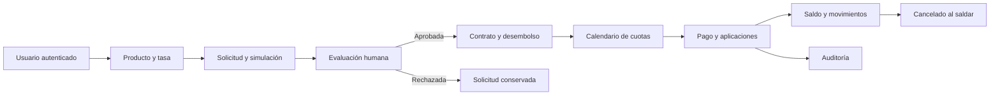

# Productos, solicitudes, préstamos y pagos

## Puesta en marcha

1. Iniciar MySQL en XAMPP. La base `capitalwest` de 27 tablas ya instalada es suficiente: no hay migración ni tablas nuevas en este cambio.
2. Abrir `SistemaFinanciera.sln` y ejecutar el proyecto web con IIS Express.
3. Abrir `Acceso.aspx`. Si no hay usuarios, desde localhost se muestra el alta del primer administrador. Elegir usuario, nombre, correo y contraseña propia de 8–20 caracteres y confirmarla. No existe contraseña predeterminada.
4. Crear productos y sus condiciones. Registrar o disponer de clientes activos en Clientes.
5. Crear una solicitud, simularla, iniciar evaluación y aprobarla o rechazarla.
6. En Préstamos, seleccionar una solicitud aprobada sin contrato y confirmar el desembolso. Consultar su detalle y tabla de cuotas.
7. En Pagos, seleccionar el préstamo y registrar un pago de cuotas exigibles a la fecha. Antes del primer vencimiento el exigible es cero y el pago se rechaza.

La contraseña se guarda como PBKDF2-SHA256 con sal aleatoria e iteraciones incluidas en el hash. Cinco fallos consecutivos bloquean temporalmente el acceso durante 15 minutos. Las cookies de autenticación se protegen mediante Forms Authentication, son de sesión y tienen expiración de 30 minutos. Los formularios de los módulos nuevos y del acceso vinculan su ViewState a un token de sesión; no se deshabilitan MAC ni EventValidation.

## Funciones disponibles

| Módulo | Funciones |
|---|---|
| Productos | Listado, creación, edición, activación/desactivación, límites de monto/cuotas/meses, métodos y periodicidades permitidos, tasa nominal/efectiva anual y capitalización, costos fijos |
| Solicitudes | Cliente/producto activos, selección de condiciones permitidas, simulación con los cinco métodos, cuotas y totales, registro, evaluación, aprobación parcial o total y rechazo con motivo |
| Préstamos | Formalización de solicitud aprobada, copia de condiciones contractuales, calendario persistido, desembolso, cartera, detalle, cuotas pagadas/parciales/vencidas y movimientos |
| Pagos | Pago parcial o completo de cuotas exigibles, desglose por cuota, recibo, usuario, saldo posterior, cancelación al completar deuda, historial de recibos e idempotencia |

El préstamo se formaliza y desembolsa en una operación; no existe un desembolso bancario externo. El estado contractual queda VIGENTE y la cartera muestra EN_MORA cuando detecta cuotas vencidas con saldo. Al aplicar un pago se persiste el estado residual correspondiente. Los préstamos cancelados conservan contratos, cuotas y recibos.

## Acceso por roles

- Administrador: todas las operaciones nuevas, incluida configuración, evaluación, aprobación/rechazo y desembolso.
- Oficial de crédito: crear solicitudes, simular y consultar; no aprobar ni desembolsar.
- Cajero: registrar pagos y consultar.
- Consulta: consultar, sin operaciones de escritura.

Las operaciones de escritura vuelven a consultar el usuario activo y sus roles dentro de la transacción. Ocultar formularios no sustituye esa autorización. El alta inicial solo crea el primer administrador; la pantalla de administración de otros usuarios continúa pendiente. Los cuatro roles ya existen en el catálogo.

El módulo existente de Clientes y el dashboard conservan su acceso anterior; este cambio protege las pantallas financieras nuevas. Completar la autorización de clientes, la administración general y las pantallas independientes de reportes/auditoría sigue siendo trabajo separado. La simulación está integrada en Solicitudes; la ruta independiente Simulador no se implementó aquí.

## Condiciones y límites de esta versión

- Costos fijos en balboas, retenidos del monto aprobado; neto entregado = monto aprobado − comisión − gastos. No se vuelven a cobrar en las cuotas. No se configura comisión porcentual en esta interfaz.
- Las condiciones se copian a la solicitud y después al contrato. Cambiar una tasa de producto no altera una solicitud ya pactada ni un préstamo. Las tasas anteriores se conservan inactivas.
- No se permite retirar métodos o periodicidades utilizados por solicitudes/contratos; crear un producto distinto para otros esquemas. Las asociaciones aún no utilizadas sí se pueden retirar.
- Los productos limitan monto, número de cuotas y plazo equivalente en meses (n × 12 / períodos por año). Hasta 1200 cuotas/meses; tasa anual 0–100 %, con hasta seis decimales. Importes con máximo dos decimales.
- La fecha prevista de la solicitud puede diferir de la contractual. Al desembolsar se exige un período completo desde la fecha actual de Panamá: AddMonths(intervalo) o AddDays(intervalo). No se prorratean períodos irregulares.
- Las fechas siguientes se calculan desde la primera fecha de pago, preservando su ancla; 31 de enero → 28 de febrero → 31 de marzo. Quincenal significa intervalos de 15 días, con 24 períodos contractuales/año como establece el catálogo. No son fechas fijas 15/fin de mes ni se ajustan feriados.
- Se aprueba mediante decisión humana. Se muestra ingreso y cuota máxima estimados; no hay aprobación automática basada en una relación cuota/ingreso.
- Pago normal sobre cuotas vencidas o que vencen hoy, en orden de antigüedad; dentro de cada cuota: mora, otros cargos, intereses, capital. No se cobra el interés futuro del plan como deuda actual.
- Solo se aceptan pagos con fecha operativa actual de Panamá. Las transferencias, cheques y tarjetas requieren referencia. No hay integración bancaria; son registros internos.
- No se genera mora monetaria nueva automáticamente. La detección de atraso sí está disponible y los cargos ya existentes en cuotas se desglosan. La tasa/gracia de mora deben acordarse antes de implementar el devengo automático.
- No se implementan en este flujo abonos anticipados, anulación de recibos, liquidación anticipada, refinanciamiento ni reestructuración. Las tablas existentes para extensiones se conservan.
- Interés compuesto: modalidad de capitalización proyectada con un único pago al vencimiento, documentada en Calculos_financieros.md. No se crea una capitalización contable anticipada del interés futuro.

## Transacciones y repetición de envíos

Crear/editar producto y su tasa, registrar solicitud, evaluar, formalizar y pagar se confirman o revierten como unidades. La aprobación exige versión vigente de solicitud; formalización bloquea la solicitud y su clave única impide un segundo préstamo. Los préstamos se bloquean antes de calcular/aplicar pagos.

Cada formulario de solicitud tiene una clave propia usada en NumeroSolicitud. Repetir exactamente el envío devuelve el registro existente; cambiar el contenido con esa clave se rechaza. El botón Nueva solicitud genera un formulario nuevo.

Cada formulario de pago tiene una clave de idempotencia. Repetir los mismos datos devuelve el recibo existente; reutilizarla con importe, fecha, usuario, préstamo, forma o referencia distintos se rechaza. Dos solicitudes simultáneas con la misma clave crean un solo recibo. Al cambiar de préstamo se genera otra clave.

Se insertan recibo, aplicaciones, movimientos, saldo del préstamo y auditoría en la misma transacción. El interés contractual y los cargos de cada cuota se reconocen una sola vez al entrar esa cuota en cobro. Movimientos de operación usan hora local de Panamá; las columnas Utc y las marcas de aprobación/desembolso se almacenan desde UTC. La tabla de movimientos del detalle ordena por fecha e identificador para conservar el orden de contabilización.

## Arquitectura y archivos

- Entities/Finanzas.vb: comandos y condiciones de cálculo, cuota y usuario con roles.
- BL/CalculosPrestamos.vb: interfaz, registro extensible y cinco algoritmos.
- BL/FinanzasServicio.vb: validación, coordinación, autenticación y claves.
- DAL/FinanzasRepositorio.vb: consultas parametrizadas, operaciones atómicas, bloqueos, restricciones de estado y autorización en transacción.
- Web/FinanzasPagina.vb: protección de páginas, token de formulario, conversión de campos y manejo de errores.
- Acceso.aspx y las páginas de Productos, Solicitudes, Préstamos/Detalle y Pagos: presentación Web Forms.

## Verificación

La solución y todo el marcado ASPX se compilan con MSBuild y aspnet_compiler de .NET Framework 4.8. Las pruebas financieras se ejecutan sobre `capitalwest_pruebas_finanzas`, una base temporal independiente creada con el mismo script del repositorio. El lanzador rechaza otro nombre de base.

`Tests/ProbarFinanzas.ps1 -Conexion 'Server=127.0.0.1;Database=capitalwest_pruebas_finanzas;User ID=root;Password=;'`

Antes de ejecutar, importar el esquema en esa base aislada vacía adaptando CREATE DATABASE/USE. El script exige base limpia: crea usuarios y operaciones ficticias. No apuntarlo a capitalwest. Las pruebas no dependen de una contraseña del usuario.

Pruebas: métodos y escenarios de monto/plazo, tasa cero, fechas, redondeo, conversión de tasas, contraseña, permisos, producto, simulación, solicitud, versión, aprobación/rechazo, condiciones históricas, formalización única, deuda exigible, pagos parciales y concurrentes, sobrepago, desglose, cancelación y estado de cuenta. La modificación de vencimientos en la fixture sirve únicamente para probar el cobro sin esperar meses; no forma parte de la aplicación.

Resultado de esta entrega: 85 pruebas financieras aprobadas, 96 comprobaciones de regresión de clientes aprobadas y precompilación ASPX correcta. Se verificó en navegador acceso protegido, edición de producto, simulación, creación/evaluación/aprobación de solicitud, contrato y recibos. La prueba visual usó una copia web temporal conectada a la base aislada; no se crearon usuarios ni contratos de prueba en capitalwest.
